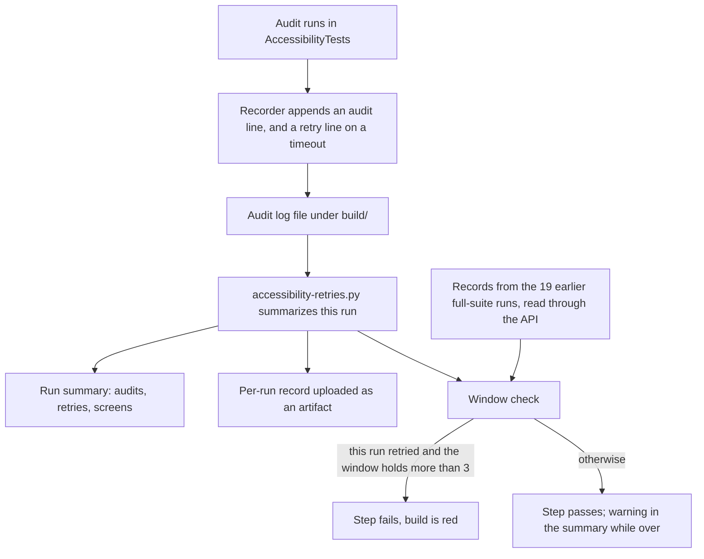

# Phase 0 Follow-Up - Plan

## Goal Capsule

- **Objective:** Before Phase 1 starts, a red build cannot go unnoticed, a routine push costs far fewer billed macOS minutes, the minimum supported macOS is tested every week, a rising accessibility flake rate turns the build red, and the Phase 1 plan on `main` states the first-rows and signing requirements.
- **Means:** Five commits, one per follow-up item, on a follow-up branch that is pushed only when all five exist and proved on one draft pull request (KTD1).
- **Authority:** The requirements R1 to R19 are the user's brief and are settled. Where a KTD and an R disagree, the R wins. Items under Assumptions are unconfirmed bets and may be changed by the user without reopening the requirements.
- **Execution profile:** Mostly workflow, script and documentation work. XCUITest cannot run on the development Mac at present, so every UI-test claim is proved by CI on the pull request.
- **Stop and tell the user when:**
  - the macOS 15 run is red after one fix round, or takes 7 minutes or longer (R11);
  - the macOS 15 runner has no Xcode 26 (R11);
  - the follow-up's own CI spend is projected to pass 500 billed minutes;
  - a CI run is red and the cause is not understood. Do not stack another push on it (R19).
- **Who finishes:** The implementer lands all five units, proves them with the runs in the Verification Contract, and fast-forwards `main`. Nothing is handed to a later phase except the items under Deferred to Follow-Up Work.

---

## Product Contract

### Summary

Five changes close out Phase 0. `CLAUDE.md` gains the working rules for CI, pushing and branches. The CI workflow stops running the full suite where it is not needed and prints what each run cost. A weekly workflow tests macOS 15. The accessibility audit's single retry is counted, shown in every run summary and gated. The Phase 1A plan arrives on `main` with the first-rows requirement and the Phase 1 signing requirement written in.

### Problem Frame

Phase 0 ended with three gaps that its review and its own lessons exposed.

Two commits went red on `main` because CI's result was not checked before the next step was pushed (`docs/solutions/2026-10-09-accessibility-notes.md`). The cause was a macOS difference: the audit passed on the development Mac (macOS 27) and failed on the runner (macOS 26). Nothing in `CLAUDE.md` yet says to wait for CI, and nothing tests macOS 15, which is the minimum the project promises.

CI is expensive. The repository is private, macOS minutes bill at ten times the Linux rate, and a run of about 5 minutes costs about 50 billed minutes. The workflow runs the whole suite on every trigger, including changes that only touch documents.

The accessibility audit times out about once in ten runs on the development Mac. The test retries once and says so only inside the result bundle, so nobody can see whether the rate is rising. `CONTRIBUTING.md` forbids silent retries.

The performance baseline shows 0.266 s to first rows for 10,000 items against a 200 ms target, because the whole folder is sorted before anything is shown. The plan that should carry the fix, `plans/phase-1a-browse.md`, exists only on a parked local branch.

### Requirements

**Working rules (item 2)**

- R1. `CLAUDE.md` states: never start a new step or push on top of a red CI run; after each push, wait for CI with `gh run watch` and fix a red run before continuing.
- R2. `CLAUDE.md` states: commit after every step; push at milestones, not after every commit.
- R3. `CLAUDE.md` states: starting in Phase 1, work on a branch and open a pull request; merge only when CI is green; `main` stays green.
- R4. `CLAUDE.md` records the macOS split: the CI runner is macOS 26, the development Mac is macOS 27, the minimum supported is macOS 15. It says accessibility and UI behavior can differ between them, so a local pass does not mean CI will pass.

**CI cost (item 3)**

- R5. A newer push cancels an older run still in progress on the same branch.
- R6. The full UI and accessibility suite runs only on pull requests and on `main`. Other pushes run the build and the unit tests.
- R7. A docs-only change (`*.md`, `plans/`, `docs/`) skips CI.
- R8. `CONTRIBUTING.md` carries a note on the cost of a run and the monthly allowance.
- R9. The workflow prints its own run duration.

**macOS 15 check (item 4)**

- R10. A scheduled workflow (weekly cron plus `workflow_dispatch`) builds the app and runs the unit and UI tests on a macOS 15 runner.
- R11. If that workflow is not stable, or costs more than about 300 billed minutes a month, the user is told. No test is dropped silently to make it pass or to make it cheaper.

**Accessibility retry visibility (item 5)**

- R12. The audit keeps its single retry.
- R13. Every retry is logged to the run summary.
- R14. The build fails when retries exceed a small threshold over a rolling window of runs.
- R15. The threshold is documented.

**Phase 1 plan (item 6)**

- R16. The "browse" milestone has an explicit requirement: show the first unsorted batch of rows immediately, then sort in the background.
- R17. That requirement comes with a performance test at the 200 ms target for a 10,000-item folder.
- R18. The plan states that Developer ID signing and notarization are required by the end of Phase 1, and that the CI build is ad hoc signed and is not a release.

**Delivery**

- R19. One commit per item with its tests in the same commit. Nothing is pushed until all five commits exist. Nothing is pushed or started on top of a red CI run. Git history is not rewritten.

### Success Criteria

- A push to a branch that has no pull request costs clearly less than the roughly 50 billed minutes a full run costs today. The duration line from R9 is the evidence.
- A reader of any full-suite run summary can see how many accessibility audits ran, how many retried, and where the rolling count stands against the threshold.

### Scope Boundaries

Considered and not built:

- **A cheap Linux job that runs the governance check on docs-only changes.** R7 means a change that breaks a statement `scripts/check-governance.sh` requires in a Markdown file reaches `main` unchecked. The next code push catches it, and `make lint` catches it locally before the commit. Build this if a governance failure ever reaches `main` that way.
- **A static check of the workflow files, or `actionlint`.** The cost controls are proved by observed runs. Build one if a cost control is removed by accident.
- **A hook that forces an audit timeout on CI.** The retry line and the audit line go through one recorder, so a run that records its audits proves the channel. A forced run would cost 50 billed minutes.
- **A reset switch for the retry window.** KTD10's rule fails only runs that retried, so the build cannot stay red on its own.
- **Lint and the performance tests on macOS 15.** The runner's Xcode differs from the pinned one, so formatting results would not be comparable, and R10 asks for build, unit and UI tests only.
- **Reading the account's real Actions usage.** The billing API needs a token scope this repository does not have. The note in R8 gives the arithmetic instead.

#### Deferred to Follow-Up Work

- When branch protection is enabled, a required **Build and test** check never reports on a docs-only pull request, so the pull request cannot merge. Replace the workflow-level path filter with a job that reports success without building. `scripts/protect-main.sh` is the trigger.
- Bring the parked branch `phase-1a/navigation-history` up to date with `main` when Phase 1 starts. It adds `plans/phase-1a-browse.md` too, so the file will conflict; keep the version from `main`.
- Record a performance baseline on the runner model before gating performance in CI (already noted in `docs/solutions/2026-10-09-ci-notes.md`).
- Copy R16 to R18 into the Claude Doc "Mac file manager implementation plan" if the user wants the source plan to match.

### Open Questions

None blocks implementation. Two need the user's eye after the first runs:

- The monthly allowance. GitHub's billing page lists 2,000 minutes a month for GitHub Free and 3,000 for Pro on private repositories. The account's own plan and current usage were not read. R8's note states the figure as GitHub's published number, not as a reading of the account.
- The retry threshold in KTD10 is a starting value. The retry rate on the CI runner is unknown.

---

## Planning Contract

### Key Technical Decisions

- KTD1. **The follow-up is committed on a branch, pushed in stages at the end, and proved on one draft pull request before `main` moves.** Three of the five units change workflows, and `docs/solutions/2026-10-09-ci-notes.md` says to trial a workflow on a branch with a draft pull request. `main` is then fast-forwarded to the branch tip, which keeps every commit and rewrites nothing (R19). The staged pushes are what let four behaviors be observed for the price of about five runs; see the Verification Contract.
- KTD2. **Superseded runs are cancelled on every ref except `main`. On `main` each push gets its own concurrency group, so its run is neither cancelled nor evicted from the queue.** The workflow already cancels on every ref, which the Phase 0 review flagged (finding 9): two quick pushes to `main` leave the first without a result or an uploaded build. Turning cancellation off for `main` is not enough, because GitHub keeps only one pending run per group and drops an older pending run when a newer one queues. The comment "Every commit on main gets a downloadable build" becomes "every push to main", which is what was ever true and is all R2 leaves possible. This satisfies R5 for every branch a developer pushes work to.
- KTD3. **The two tiers are one job with conditions on the UI-test and performance steps, not two jobs or two workflows.** The check keeps its name, **Build and test**, which `scripts/protect-main.sh` requires, and the step list stays in one place. The full tier runs when the event is a pull request or the ref is `main`.
- KTD4. **A push to a branch that already has an open pull request does not run the macOS job.** R6 needs a push trigger for every branch, and a branch with a pull request then fires both events. From Phase 1 nearly every push is to such a branch (R3), so without this each push would cost a light run on top of the full one and R6 would raise the bill. A small Linux job runs `scripts/ci-pull-request-lookup.sh`, and the macOS job is skipped only when every open pull request for the branch is at the pushed commit and GitHub reports it mergeable. GitHub starts no pull-request run while a pull request has a merge conflict, so a conflict, mergeability still unknown after a short wait, no pull request, a tag push or a failed lookup all run the macOS job. Linux minutes bill at the base rate. (Narrowed after the review of this follow-up: the first version skipped for any open pull request.)
- KTD5. **Docs-only changes are filtered at the trigger with `paths-ignore` for `**/*.md`, `plans/**` and `docs/**`, on both events.** Two consequences are accepted. A push is judged by the commits pushed, but a pull request is judged by its whole diff, so a docs-only commit added to a pull request that also changes code still runs. `docs/performance/baseline.json` sits under `docs/`, so a change to it alone runs nothing; the baseline is only recorded on the reference Mac.
- KTD6. **Duration comes from a script, `scripts/ci-duration.sh`, given a start time the job's first step records.** It prints elapsed time, billed minutes (whole minutes rounded up, times ten) and writes the same line to the run summary. A script can have a self-test; an inline expression cannot. The step runs even when an earlier step failed.
- KTD7. **The macOS 15 check is its own workflow, `.github/workflows/macos-15.yml`, on the `macos-15` runner, and it also runs on a pull request that changes the workflow file or the Xcode selection script.** `workflow_dispatch` only works for a workflow already on the default branch, so without the pull-request trigger the workflow could not be tried before it lands. It selects the newest installed Xcode 26 and fails with a plain message if there is none, instead of falling back to the runner's default Xcode 16.
- KTD8. **The test records audits and retries by appending lines to a file named in an environment variable.** `xcodebuild` passes variables prefixed `TEST_RUNNER_` to the test process with the prefix removed, and `make uitest` sets one. Without the variable the recorder does nothing, so running tests from Xcode is unchanged. It records every audit, not only retries, because a file with no retries looks the same as a recorder that never ran (`docs/solutions/2026-10-09-checks-that-pass-without-checking.md`). (Changed after the first run on a runner: the UI test runner is sandboxed and cannot write a file in the checkout, so the test logs each record as a marked line, `xcodebuild` prints it, and `make uitest` extracts the records from the output with `scripts/accessibility-retries.py extract`.)
- KTD9. **The rolling window is rebuilt on each run from small per-run artifacts read through the GitHub API, not kept in an Actions cache.** Most full-suite runs will be pull-request runs (R3). A cache saved by a pull request is invisible to `main` and to other pull requests, so a cache could only count `main` runs, which R2 makes rare. An artifact from any run is readable by every later run.
- KTD10. **Window: the 20 most recent full-suite runs, the current one included. Threshold: 3 retries. A run fails when it retried and the window then holds more than 3.** A run that did not retry passes whatever the count, and the summary shows a warning while the count is over. This keeps one bad week from turning every later run red until 20 runs have passed, which a plain "count over threshold" rule would do. A run whose UI tests ran but recorded no audits fails, because the recording is broken. If the history cannot be read, the run passes and the summary says the count is unknown. The numbers live in `scripts/accessibility-retries.py` and are documented in `CONTRIBUTING.md`; the script's self-test checks the two agree.
- KTD11. **`plans/phase-1a-browse.md` is brought onto `main` from the parked branch and edited there, with a short "Phase 1 exit requirements" section for signing.** There is no Phase 1 plan file on `main`, and the parked branch is unreviewed work in progress that should not be merged to deliver one document. The exit requirement is Phase 1-wide but sits in the 1A file until a plan for the whole phase exists; `CLAUDE.md` points to it.

### Assumptions

These are unconfirmed bets. Each one can be changed without touching the requirements.

- The follow-up runs on a branch and a draft pull request (KTD1), although R3 applies branches only from Phase 1.
- Commit order is item 2, 3, 6, 4, 5, not 2 to 6, so the docs-only commit can be pushed on its own to prove R7 at no cost.
- `main` is exempt from cancellation (KTD2). R5 as written says "same branch" without an exception.
- Pushes to a branch with an open pull request skip the macOS job (KTD4). R6 as written says other pushes run build plus unit tests.
- A light run takes roughly half the time of a full run. Not measured; the first staged push measures it.
- The `macos-15` runner image carries Xcode 26.0.1 to 26.3 and not the pinned 26.6, and its default is Xcode 16.4. Read from the runner image's published software list on 2026-10-09, not from a run. The code has not been compiled with an Xcode older than 26.6.
- The weekly run takes 6 minutes or less, which is 60 billed minutes a run and about 260 a month. At 7 minutes it is about 303 a month and R11's limit is crossed.
- "Stable" for R11 means the pull-request run is green and the first four scheduled runs are green or fail for a reason that is a real defect.
- The retry window and threshold in KTD10.
- The UI test process can write to a path under `build/`. The test bundle has no sandbox setting in `project.yml`.
- The repository copy of the Phase 1 plan is the one R16 to R18 mean. The Claude Doc is not edited.
- Commit `9a7bc52` on `main` has not been pushed and has had no CI run. The first staged push carries it.

### High-Level Technical Design

What runs for each event after U2 and U3:

| Event | Docs-only change | Otherwise |
| --- | --- | --- |
| Push to `main` | Nothing | Full tier, then package and upload the build |
| Pull request opened or updated | Nothing, when the whole pull-request diff is docs-only | Full tier |
| Push to another branch, no open pull request | Nothing | Light tier: bootstrap, lint, build, unit tests |
| Push to another branch with an open, mergeable pull request | Nothing | Linux lookup job only; the pull-request run covers the commit |
| Push to another branch whose pull request has a conflict, or whose mergeability stays unknown | Nothing | Linux lookup job, then the light tier |
| Weekly schedule or manual dispatch | Not applicable | macOS 15: bootstrap, build, unit tests, UI tests |
| Pull request that changes the macOS 15 workflow or the Xcode selection script | Not applicable | macOS 15 run as well as the pull-request run |

The full tier is the light tier plus the UI tests (which include the accessibility audits), the retry accounting from U4, and the performance tests.

How an audit retry reaches the build result (U4):

### Sequencing

Commit order is U1, U2, U5, U3, U4. U5 is documents only and is placed third so it can be pushed alone. U3 uses the duration script from U2. U4 edits both workflows, so it follows U2 and U3.

### Risks and Dependencies

- **macOS 15 may fail the accessibility audit for reasons that are the system's, not the app's.** The audit already differs between macOS 26 and 27. A narrow, explained exception of the kind already in `UITests/AccessibilityTests.swift` is in scope for U3. Anything larger triggers the stop condition.
- **The older Xcode on the macOS 15 runner may not compile the code.** The packages declare tools version 6.0 and `scripts/bootstrap.sh` accepts any Xcode 26, but the code has only been built with 26.6. A compile failure triggers the stop condition; do not lower the code to fit without asking.
- **Every push to the follow-up pull request after U3 lands re-runs the macOS 15 workflow**, because a pull request's path filter sees the whole diff. Batch fixes into as few pushes as possible.
- **Artifacts in a private repository expire after at most 90 days.** Older runs fall out of the retry window, which is harmless.
- **`9a7bc52` is untested by CI.** If the first full run is red because of it, fix forward in a new commit.

### Sources and Research

- `.github/workflows/ci.yml`: current triggers, the existing concurrency block, the step order and the `pipefail` pattern to copy for any new piped step.
- `scripts/check-governance.sh` and `scripts/test-check-governance.sh`: the `require_text` pattern and the copy-and-break self-test pattern U1 extends.
- `scripts/ci-select-xcode.sh` and `scripts/test-ci-select-xcode.sh`: selection order and the fake-Applications-folder test pattern U3 extends.
- `scripts/performance.py` and `scripts/test-performance.sh`: the shape of a Python tool with a shell self-test wired into `make test`, which U4 mirrors.
- `scripts/check-main-thread-guard.sh`: `TestSupport` is exempt from the main-thread guard check, so the recorder can live there.
- `docs/solutions/2026-10-09-ci-notes.md`, `docs/solutions/2026-10-09-checks-that-pass-without-checking.md`, `docs/solutions/2026-10-09-accessibility-notes.md`: the lessons KTD1, KTD8 and U3's risk rest on.
- `docs/performance/README.md` and `docs/performance/baseline.json`: 0.266 s to first rows, 54 ms listing and 144 ms sorting at 10,000 items.
- `Packages/BrowserUI/Sources/BrowserUI/BrowserModel.swift`, `load()`: the whole listing is sorted before `items` is published, inside the `LoadFolder` signpost interval.
- GitHub Actions runner image list for `macos-15` (arm64) and GitHub's Actions billing page, both read 2026-10-09.

---

## Implementation Units

### U1. Working rules in CLAUDE.md (item 2)

- **Goal:** `CLAUDE.md` tells the next session how to treat CI, pushes, branches and the three macOS versions.
- **Requirements:** R1, R2, R3, R4
- **Dependencies:** None
- **Files:**
  - `CLAUDE.md`
  - `CONTRIBUTING.md`
  - `scripts/check-governance.sh`
  - `scripts/test-check-governance.sh`
- **Approach:**
  1. Replace step 5 of "The loop for each step", which now ends "then push", with a commit-only step, and add a section for the CI and push rules of R1 to R3.
  2. Add the macOS split of R4 beside the Toolchain table, naming the runner label `macos-26`.
  3. Update the Decisions row "Workflow" and the Status paragraph so neither contradicts the new rules.
  4. In `CONTRIBUTING.md`, add to "Commits" that from Phase 1 changes arrive by pull request and merge only on a green check. Keep the sentence "One commit per step", which the governance check requires.
  5. Add one `require_text` line per rule to the governance check, matching a phrase that carries the rule's meaning (`gh run watch`, pushing at milestones, the pull-request rule, the three macOS versions).
- **Patterns to follow:** `require_text` in `scripts/check-governance.sh`; the `copy_repo` then `sed` then `expect_fail` cases in `scripts/test-check-governance.sh`.
- **Test scenarios:**
  - The governance check passes on the repository after the edits.
  - A copy with the `gh run watch` sentence removed from `CLAUDE.md` fails the check.
  - A copy with the push-at-milestones sentence removed fails the check.
  - A copy with the pull-request rule removed fails the check.
  - A copy with the macOS version split removed fails the check.
- **Verification:** `make lint` and `make test` pass. Each new governance line has been seen to fail on a broken copy.

### U2. Cut CI cost (item 3)

- **Goal:** A push costs only what its event needs, docs-only changes cost nothing, and each run states its own cost.
- **Requirements:** R5, R6, R7, R8, R9
- **Dependencies:** U1 (both edit `CONTRIBUTING.md`)
- **Files:**
  - `.github/workflows/ci.yml`
  - `scripts/ci-duration.sh` (new)
  - `scripts/test-ci-duration.sh` (new)
  - `Makefile`
  - `CONTRIBUTING.md`
- **Approach:**
  1. Triggers: push on every branch and pull request, both with the path filter of KTD5.
  2. Concurrency per KTD2, and correct the comment above the Package step.
  3. Add the lookup job of KTD4 on a Linux runner with read access to pull requests. It runs only for a push to a branch other than `main`.
  4. Put the full-tier condition of KTD3 on the UI-test and performance steps. Give the UI-test step an `id`, which U4 needs.
  5. Record the start time in the job's first step and add the duration step of KTD6 last, set to run always.
  6. Add the duration self-test to the `test` target in the `Makefile`.
  7. Rewrite the paragraph that ends "Before you open a pull request" in `CONTRIBUTING.md` to describe the two tiers and the docs-only skip, including that a pull request is judged by its whole diff. Add the cost note of R8: about 5 minutes and 50 billed minutes for a full run, the tenfold rate, GitHub's published allowance of 2,000 minutes a month on the free plan, and so about 40 full runs a month.
- **Technical design:** Directional only. The macOS job runs when the lookup job was skipped (pull request, or `main`) or when it reported no open pull request or an error.
- **Patterns to follow:** `scripts/test-ci-select-xcode.sh` for a small shell self-test; the `pipefail` block in the Performance tests step for anything piped.
- **Test scenarios:**
  - A start time 333 seconds before the given end time prints 5 min 33 s and 60 billed minutes.
  - Exactly 300 seconds prints 5 min 0 s and 50 billed minutes.
  - 1 second prints 10 billed minutes.
  - A missing or non-numeric start time exits non-zero with a message and prints no duration.
  - With a summary file path set, the same line is appended to that file.
  - On CI: a push to a branch with no pull request skips the UI-test and performance steps and prints its duration.
  - On CI: a docs-only push to that branch starts no run.
  - On CI: a pull request runs the UI-test and performance steps.
  - On CI: a push to a branch with an open pull request runs the lookup job and skips the macOS job.
- **Verification:** `make test` passes with the new self-test. The four CI behaviors are observed in the staged pushes of the Verification Contract. The cancellation exception for `main` is verified by reading the workflow, not by a run; proving it would take two back-to-back pushes to `main` and about 100 billed minutes.

### U3. Weekly macOS 15 check (item 4)

- **Goal:** The minimum supported macOS is built and tested once a week, and a failure or an over-budget run reaches the user.
- **Requirements:** R10, R11
- **Dependencies:** U2 (duration script)
- **Files:**
  - `.github/workflows/macos-15.yml` (new)
  - `scripts/ci-select-xcode.sh`
  - `scripts/test-ci-select-xcode.sh`
  - `CLAUDE.md`
  - `CONTRIBUTING.md`
- **Approach:**
  1. Workflow triggers per KTD7: a weekly cron, `workflow_dispatch`, and a pull request that touches the workflow file or `scripts/ci-select-xcode.sh`. Give it its own concurrency group with cancellation.
  2. Steps: checkout, select Xcode in strict mode, write the macOS, Xcode and Swift versions to the run summary, bootstrap, build, unit tests, UI tests, upload test results on failure, duration.
  3. Add a strict mode to the selection script, off by default, that exits non-zero when neither the pinned Xcode nor one of the same major version is installed. `ci.yml` keeps the current fallback.
  4. Have the duration step also print the projected monthly cost for a weekly run, and emit a warning annotation when the run took 7 minutes or longer.
  5. Add to `CLAUDE.md` that the weekly macOS 15 run exists, that a red one is treated like red CI (R1), and add its cost to the note in `CONTRIBUTING.md`.
- **Execution note:** This is mostly configuration. The proof is the pull-request run, not a unit test. Read its summary for the Xcode actually selected before trusting the result.
- **Patterns to follow:** The step order of `.github/workflows/ci.yml`; the `fresh` and `expect` helpers in `scripts/test-ci-select-xcode.sh`.
- **Test scenarios:**
  - Strict mode with the pinned Xcode present selects it, as before.
  - Strict mode with only an older Xcode of the same major version selects the newest of them.
  - Strict mode with only another major version and the default `Xcode.app` exits non-zero and prints no `DEVELOPER_DIR` line.
  - Without strict mode that same folder still selects `Xcode.app`.
  - On CI: the pull-request run on `macos-15` builds, passes the unit tests and the UI tests, and its summary names macOS 15 and the Xcode chosen.
- **Verification:** `make test` passes. The pull-request run is green in 6 minutes or less. If it is red after one fix round, or slower, or no Xcode 26 is found, stop and report to the user with the failing tests, the measured duration and the options; do not remove a test or the workflow to get a green result.

### U4. Accessibility retry visibility (item 5)

- **Goal:** Each full-suite run shows its audit retries, and a run that retries while the recent count is over the threshold fails.
- **Requirements:** R12, R13, R14, R15
- **Dependencies:** U2, U3
- **Files:**
  - `Packages/TestSupport/Sources/TestSupport/AuditLog.swift` (new)
  - `Packages/TestSupport/Tests/TestSupportTests/AuditLogTests.swift` (new)
  - `UITests/AccessibilityTests.swift`
  - `scripts/accessibility-retries.py` (new)
  - `scripts/test-accessibility-retries.sh` (new)
  - `Makefile`
  - `.github/workflows/ci.yml`
  - `.github/workflows/macos-15.yml`
  - `CONTRIBUTING.md`
  - `docs/solutions/2026-10-09-accessibility-notes.md`
- **Approach:**
  1. Add the recorder of KTD8 to `TestSupport`. `audit(_:_:)` calls it once when an audit starts and once more on the timeout path, before the existing activity and the single retry. The retry logic itself does not change (R12).
  2. `make uitest` clears the audit log and passes its absolute path to the test process.
  3. The script has two jobs: turn the audit log into this run's record and a Markdown summary, and apply the window rule of KTD10 to this run's record plus a folder of earlier records.
  4. In `ci.yml`, after the UI tests and only when that step ran: write the summary, upload this run's record as an artifact named for the run and attempt with 90-day retention, download the most recent earlier records through the API, then run the window check. The job needs read access to Actions.
  5. In `macos-15.yml`, write the summary only. Its retries are not mixed into the macOS 26 window and are not gated.
  6. Document the window, the threshold, what to do when the gate fails (open an issue and look, do not simply re-run) and how to change the numbers, next to the flaky-test rule in `CONTRIBUTING.md`. Update the "Known flake" section of the accessibility notes.
- **Patterns to follow:** `scripts/performance.py` for the tool's shape and `scripts/test-performance.sh` for its self-test; `TemporaryDirectory` and its tests in `TestSupport` for the recorder and its unit tests.
- **Test scenarios:**
  - Recorder: with the variable set, one audit appends one audit line naming the screen.
  - Recorder: a retry appends a retry line after the audit line for the same screen.
  - Recorder: with the variable unset, nothing is written and nothing throws.
  - Recorder: a screen name containing spaces is read back whole.
  - Recorder: two appends from two instances both survive in the file.
  - Script: a log with three audits and no retry gives a record of 3 audits and 0 retries and a summary that says so.
  - Script: a log with one retry names the screen that retried in the summary.
  - Script: an empty or missing log exits non-zero and says the recording is broken.
  - Script: this run retried, earlier records hold 3 retries, the check exits non-zero and prints the count and the threshold.
  - Script: this run retried, earlier records hold 2 retries, the check passes.
  - Script: this run did not retry, earlier records hold 5 retries, the check passes and the summary carries a warning.
  - Script: with 25 earlier records, only the newest 19 are counted with the current run.
  - Script: an empty history folder passes and the summary says the window holds 1 run.
  - Script: an unreadable record in the history is skipped and named, and the rest are counted.
  - Script: the window and threshold the tool prints are the numbers written in `CONTRIBUTING.md`.
  - Script: the self-test runs from a path that contains a space.
  - On CI: the pull-request run's summary shows three audits recorded and a window of the runs so far.
- **Verification:** `make test` passes, including the recorder's unit tests and the script's self-test. The pull-request run shows the audit count in its summary and uploads its record. A second full-suite run shows a window of two.

### U5. Phase 1 plan on main (item 6)

- **Goal:** `main` carries a Phase 1A plan that requires fast first rows by showing unsorted rows first, and states the Phase 1 signing requirement.
- **Requirements:** R16, R17, R18
- **Dependencies:** U1 (wording of the loop)
- **Files:**
  - `plans/phase-1a-browse.md` (new on `main`, taken from the parked branch `phase-1a/navigation-history`)
  - `CLAUDE.md`
- **Approach:**
  1. Take the file's content from the parked branch. Bring nothing else from that branch.
  2. Rewrite step 3, "Fast first rows", and add a requirements section for the milestone. It states that the first batch of rows is shown unsorted as soon as it is listed, that the sort runs in the background and the list then settles into order, and that a performance test asserts time to first rows of 200 ms or less for 10,000 items. Cite the baseline: 0.266 s today, 54 ms to list, 144 ms to sort.
  3. Say how the test measures it: the interval must end when the first batch reaches the list, which the current `LoadFolder` interval does not do, and the 200 ms assertion applies on the reference Mac because runner times are not comparable (`docs/performance/README.md`).
  4. Add "Phase 1 exit requirements": Developer ID signing and notarization by the end of Phase 1, and the statement that the CI build is ad hoc signed and is not a release.
  5. Replace the file's sentence about pushing after each step with a pointer to the rules U1 added.
  6. In `CLAUDE.md`, point Status at the plan file and extend the open item on Apple Developer Program membership to name signing and notarization.
- **Test scenarios:** Test expectation: none -- documentation only. Keeping this commit free of scripts is also what lets it prove R7 when pushed alone.
- **Verification:** `make lint` passes. The step table still lists ten steps. A reader of step 3 can name the behavior, the number and the test without opening another file.

---

## Verification Contract

Local, before each commit:

| Command | Proves | Units |
| --- | --- | --- |
| `make lint` | Governance statements and Swift formatting | All |
| `make test` | Script self-tests and package unit tests, including the new ones | All |
| `make build` | The app still builds after the test-support change | U4 |

`make uitest` cannot run on the development Mac at present, so UI-test results come from CI.

On CI, at the end, in this order. Wait for each run with `gh run watch` and do not continue past a red one.

| Stage | What is pushed | Expected | Proves | Est. billed min |
| --- | --- | --- | --- | --- |
| 1 | Branch up to U2, no pull request | Light run: UI-test and performance steps skipped, duration printed | R6 light tier, R9 | 25 to 30 |
| 2 | U5 alone | No run starts | R7 | 0 |
| 3 | Open a draft pull request | Full run, green | R6 full tier; first CI result for `9a7bc52` | 50 |
| 4 | U3 and U4 together | Lookup job only for the push; full run and macOS 15 run for the pull request | KTD4, R10, R11, R13 | 50 plus 60 to 70 |
| 5 | Fast-forward `main`, with the closing notes commit on top, and push `main` only | Full run with package and upload; summary shows a retry window of two | R14 window across runs | 50 |

That is about 245 billed minutes, roughly an eighth of a 2,000-minute month. Each fix push after stage 4 costs about 120 more. Stop and tell the user before the total passes 500.

Not exercised by a run: the cancellation exception for `main` (U2), an actual audit retry on CI (U4), and the `workflow_dispatch` and cron triggers themselves (the pull-request trigger runs the same job; watch the first scheduled run).

---

## Definition of Done

- Five commits, one per item, each with its tests, in the order U1, U2, U5, U3, U4. No commit was amended or rebased after it was pushed.
- One closing docs-only commit may follow them, for what only the CI stages could teach: measured durations and lessons. It is made before stage 5 and pushed to `main` only, because pushing it to the pull-request branch would start a full run and a macOS 15 run.
- R1 to R18 are each true in the tree, and every new check or self-test has been seen to fail on a broken input.
- Every stage in the Verification Contract ran and was green, or the user was told why not.
- The measured light-run duration, full-run duration and macOS 15 duration are written into `CONTRIBUTING.md`'s cost note in place of the estimates, in the closing commit.
- The macOS 15 run is green in 6 minutes or less, or the user has the report R11 requires.
- Lessons from the work are recorded in `docs/solutions/`, in the commit of the unit that produced them, or in the closing commit when they came from a CI stage.
- `main` is at the follow-up branch's tip and its run is green.
- No abandoned experiment remains in the diff: no probe commits, throwaway branches on the remote, or commented-out workflow steps.
