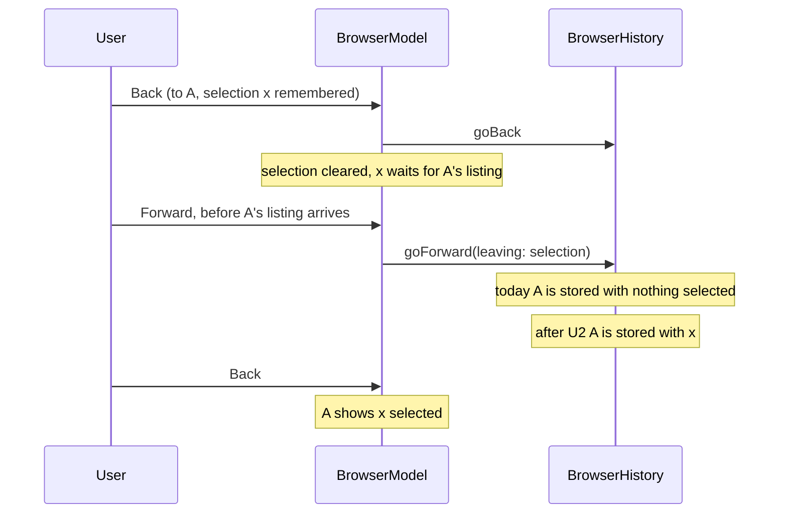

# Phase 1A Step 1 Navigation History - Plan

## Goal Capsule

- **Objective:** Someone browsing folders in Cairn can go back and forward as in Finder and finds the same items selected on return, from the keyboard, the Go menu or the toolbar, and every one of those controls is announced by VoiceOver and findable by tests.
- **Means:** Finish and prove the existing implementation in commit `339ab20` instead of rewriting it: close five gaps found by reading the code against the requirements (U1 to U5), then take the step through review, lessons, one commit and one pull request (KTD5).
- **Authority:** R1 to R16 come from the step's brief, the step 1 row of `plans/phase-1a-browse.md` and the hand-written plan this file replaces. Where a KTD and an R disagree, the R wins. Items under Assumptions are unconfirmed bets the user may change without reopening the requirements.
- **Execution profile:** Small edits to one Swift package, one check script, the UI tests and three documents. Local `make uitest` cannot judge the three accessibility-audit tests on the development Mac, so CI on the pull request is the only proof for them.
- **Stop and tell the user when:**
  - the pull-request CI run is red and the cause is not understood;
  - a second fix round is needed (each full run costs 50 to 60 billed minutes);
  - a toolbar button cannot be given a declared identifier through a standard toolbar item on the CI runner (KTD3 names the fallback, which is a larger change);
  - a fix would need a change to `.github/workflows/macos-15.yml` or `scripts/ci-select-xcode.sh`, which would start the macOS 15 workflow.
- **Who finishes:** The implementer lands U1 to U5 on branch `phase-1a/navigation-history`, runs the review and lessons steps, makes the one commit, opens the pull request and merges it when CI is green.

---

## Product Contract

### Summary

Phase 1A step 1 gives each browser a back and forward history that remembers selections. The code exists and is unreviewed. This plan states the step's requirements, shows which are already proved by code and tests, and plans only what is missing, wrong or unproved.

### Problem Frame

The step was implemented in one sitting before the project adopted the plan, work, review and lessons loop, and its final lint and test run was interrupted. It was then rebased over three fixes on `main`: the macOS 15 root rule in `BrowserModel.enclosingFolder`, cancelling a load only for actions that start one, and the `fill` cell helper. The rebase merged `navigateToEnclosingFolder` by hand. Nobody has checked the result against the project's standing rules, and the accessibility audit has never run on CI with a toolbar in the window.

### Requirements

**Navigation**

- R1. Each browser has its own back and forward history.
- R2. Going back or forward restores the selection that was showing in that folder when it was left.
- R3. Going to the enclosing folder selects the folder just left, as Finder does, records the move in the history, and does nothing at the root on every supported macOS.
- R4. Reloading the folder already showing keeps the selection of items that still exist.
- R5. Visiting a folder discards forward history, visiting the folder already showing changes nothing, and the history keeps the newest 100 places.

**Controls**

- R6. The toolbar has Back and Forward buttons, each enabled only when it can do something.
- R7. The Go menu has Back (Command-[) and Forward (Command-]) beside Enclosing Folder (Command-Up), each enabled only when it can do something.
- R8. Every navigation action can be done from the keyboard alone.
- R9. Every control has an accessibility identifier and a spoken label, set only through `AccessibilityElement` and its apply helpers.

**Standing rules**

- R10. No file-system call runs on the main thread.
- R11. A command that cannot do anything leaves a folder load in flight to finish.
- R12. No API newer than macOS 15 is used without `#available` and a macOS 15 fallback.

**Proof**

- R13. Unit tests cover the history model and the browser model.
- R14. End-to-end tests cover back and forward, selection restore, the enclosing folder, and the enabled state of the controls.

**Documents and delivery**

- R15. `README.md`, `CLAUDE.md` and `ARCHITECTURE.md` describe the app as it is after this step, and `docs/solutions/` holds the step's lessons without advice the final code contradicts.
- R16. The step lands as one commit named `Phase 1 step 1: navigation history` on `phase-1a/navigation-history`, through a pull request merged only when CI is green.

### Scope Boundaries

Out of scope for this step:

- Tabs, the sidebar and the path bar (steps 2, 8 and 9), which will navigate through this history.
- Restoring history after a quit (step 10).
- A history menu on the Back button, and trackpad swipe navigation. Neither was asked for.

Considered and not built:

- A cap on the selection remembered per history entry. A 10,000-item selection held in 100 entries is large but nobody has measured it as a problem. A memory report from a real session would change the call.
- Case-insensitive place comparison. Every location today comes from a listing or a launch argument, so two spellings of one folder cannot both arrive. Go to Folder (step 9) is where a typed path first can.

#### Deferred to Follow-Up Work

- `InitialLocation.resolve` calls `standardizedFileURL` at launch on the main thread, the same existence check KTD2 removes from navigation. It is launch code from Phase 0, not part of this step.
- Deciding on purpose whether a folder reached through a symbolic link keeps the path as typed (`docs/solutions/2026-10-09-listing-a-symlinked-location.md`).
- The window title of a location such as `/Users/..` reads `..`. It predates this step.

---

## Planning Contract

### Requirement-to-evidence map

Read against the rebased branch (`339ab20` on `fd56498`). "Proved" means the named code and tests exist and assert the behavior. No test was run while planning.

| Req | State | Evidence in `339ab20` | Remaining |
| --- | --- | --- | --- |
| R1 | Proved | `BrowserHistory`, owned by `BrowserModel`, one per `BrowserViewController`. `BrowserHistoryTests.backAndForwardRetraceVisits`, `BrowserModelTests.backAndForwardRetraceNavigation`, `HistoryTests.testBackAndForwardWithTheKeyboard`. Toolbar and menu items have no target, so they reach the focused browser. | None |
| R2 | Gap | `BrowserModelTests.goingBackRestoresWhatWasSelected`, `BrowserHistoryTests.remembersTheSelectionLeftBehindInBothDirections`, `HistoryTests.testGoingBackRestoresTheSelection`. Leaving a folder before its listing arrives records an empty selection for it. | U2 |
| R3 | Proved, one assertion missing | The hand-merged `navigateToEnclosingFolder` guards on `enclosingFolder`, records the visit and selects the child. `BrowserModelTests.goingToTheEnclosingFolderSelectsTheFolderJustLeft`, `navigatesToTheEnclosingFolderAndStopsAtTheRoot`, `HistoryTests.testEnclosingFolderSelectsTheFolderJustLeft`. No test asserts the root case leaves the history empty. | U2 |
| R4 | Model proved, view unproved | `BrowserModelTests.reloadingKeepsTheSelectionOfItemsThatStillExist`. No test reloads through the table, where `reloadData` runs outside the echo guard. | U2 |
| R5 | Proved | `BrowserHistoryTests`: `visitingAfterGoingBackDiscardsForwardHistory`, `visitingTheCurrentFolderChangesNothing`, `keepsOnlyTheNewestEntries`. | None |
| R6 | Proved | `BrowserViewController.validateUserInterfaceItem`, `BrowserViewControllerTests.enablesBackAndForwardOnlyWhenThereIsHistory`, `HistoryTests.testToolbarButtonsAreEnabledOnlyWhenThereIsHistory`. | None (U4 changes how the test finds the buttons) |
| R7 | Shortcuts proved, enabled state unproved | `App/MainMenu.swift`. Command-[ and Command-] are exercised by `testBackAndForwardWithTheKeyboard`. No test reads the menu items' enabled state, and no unit test covers validation of Enclosing Folder. | U1 |
| R8 | Proved | Command-[, Command-], Command-Up and Command-O are exercised by `HistoryTests` and `AccessibilityTests.testAFolderCanBeOpenedAndLeftWithTheKeyboardAlone`. The toolbar buttons have menu equivalents. | None |
| R9 | Not met | `BrowserToolbar` sets item identifiers and labels from string literals. Neither button is declared in `AccessibilityElement.all`, and `scripts/check-accessibility.sh` does not look at toolbar items. | U4 |
| R10 | Not met | `BrowserHistory.placeKey` and `BrowserModel.enclosingFolder` call `standardizedFileURL` on the main actor. A probe on the development Mac showed it checks whether the path exists when the path starts with `/private`. | U3 |
| R11 | Not met | `goBack(_:)` and `goForward(_:)` in `BrowserViewController` always go through `run`, which cancels the load in flight. With no history the model then does nothing and the browser stays in its loading state. `goToEnclosingFolder(_:)` and `open(row:)` already guard. | U1 |
| R12 | Proved by the build | The diff uses no API newer than macOS 15. The deployment target is 15.0 in `project.yml` and every `Package.swift`, with warnings as errors, so the compiler rejects an unguarded newer API. | None. Runtime behavior on macOS 15 is seen only by the weekly workflow (see Risks). |
| R13 | Proved, extended by U1 to U3 | `BrowserHistoryTests` (7 tests), `BrowserModelTests` history section (7 tests), `BrowserViewControllerTests` (2 tests), `BrowserToolbarTests` (1 test). | U1, U2, U3 |
| R14 | Proved, extended by U1 and U4 | Four tests in `UITests/HistoryTests.swift`. | U1, U4 |
| R15 | Partly met | `README.md` and `CLAUDE.md` status lines were updated. `ARCHITECTURE.md` still lists neither `BrowserHistory` nor `BrowserToolbar`. `docs/solutions/2026-10-09-navigation-history-notes.md` gives advice that U3 and U4 reverse. | U5 |
| R16 | Not yet | The branch holds one commit with a WIP message. | Definition of Done |

Rebase checks, by reading:

- History and the root rule agree. `navigateToEnclosingFolder` returns before touching the history when `enclosingFolder` is nil, and validation disables the menu item with the same property.
- Menu and toolbar validation share `validateUserInterfaceItem`, so one rule enables both.
- `run` is the one place the merge left wrong for this step (R11, U1).

### Key Technical Decisions

- KTD1. **Back and Forward follow the rule `main` set for `run`.** The view controller checks `canGoBack` or `canGoForward` before calling `run`, as `goToEnclosingFolder(_:)` already checks `enclosingFolder`. Menu validation normally stops the action first, but a toolbar item is validated lazily and the action can also be sent directly.
- KTD2. **Places are compared by path text alone.** One pure function turns a URL into a comparable path: it drops a trailing slash and resolves `.` and `..` over the path components, without `standardizedFileURL`. `enclosingFolder` uses the same function, so the macOS 15 root rule keeps working by counting components. Owning the function avoids a Foundation call whose result differs between macOS versions, which is how the macOS 15 root bug arose (`docs/solutions/2026-10-09-phase-0-follow-up-notes.md`). The visible change: `/tmp` and `/private/tmp` become different places, which matches what the symlink lesson already describes.
- KTD3. **Toolbar buttons stay standard toolbar items and take their identity from a declared element.** `AccessibilityElement` gains Back and Forward elements. A helper in `Accessibility.swift` is the only code that builds a toolbar item's identifier, label and image description, all from one element. Standard items keep system validation and the system's toolbar appearance on macOS 15 and 26. The fallback, if the system does not expose the item identifier as the button's accessibility identifier, is a view-based item hosting a button that takes `apply(_:)`, with validation written by hand.
- KTD4. **The convention check learns about toolbar items.** `scripts/check-accessibility.sh` rejects a toolbar item identifier built outside the helper file, with a must-fail case under a path containing a space, as `docs/solutions/2026-10-09-checks-that-pass-without-checking.md` asks of every check.
- KTD5. **Everything is in the commit before the first push.** A pull request is judged by its whole diff, so any later push, even of documents only, starts another full run. Review fixes, the lessons and the document updates are finished locally first, and the one pull-request run then judges the final tree.
- KTD6. **New end-to-end assertions join existing tests.** Each app launch adds to the billed run, so the menu and identifier checks extend `testToolbarButtonsAreEnabledOnlyWhenThereIsHistory` instead of adding launches.

### High-Level Technical Design

The selection gap in R2, which U2 closes. Today the middle step records an empty selection for A.

### Assumptions

Unconfirmed bets made without a user present.

- The text of quality bar 6 is not in the repository, and the Claude Doc that holds it could not be read during planning. R1 to R16 are assumed to cover it.
- R2 is read as holding when the user moves faster than folders load. That reading puts the pending-selection fix (U2) in scope.
- Treating `/tmp` and `/private/tmp` as different places (KTD2) is acceptable until Phase 1 decides its symbolic-link rule.
- Changing `BrowserModel.enclosingFolder`, which arrived from `main`, is in scope because R3 and R10 both depend on it.
- Extending `scripts/check-accessibility.sh` (KTD4) is in scope for a feature step.
- The macOS 15 workflow is not started by hand before the merge. R12 rests on the build, and macOS 15 runtime behavior waits for the weekly run.
- The toolbar buttons count as keyboard-operable through their menu equivalents. No test drives them with Full Keyboard Access.
- The WIP commit is amended into the single step commit, not followed by further commits.
- `docs/solutions/2026-10-09-navigation-history-notes.md` is revised in place by the lessons step, not kept beside a second file.

### Risks

| Risk | Consequence | Response |
| --- | --- | --- |
| The accessibility audit has never run on the macOS 26 runner with a toolbar in the window, and cannot be judged locally. | The first pull-request run may fail on a system toolbar finding, costing a fix round. | Read the finding with `issue.element?.debugDescription` as the accessibility notes describe. Narrow an exception only for system chrome. A second round is a stop condition. |
| Whether a standard toolbar item's identifier is the button's accessibility identifier is unverified on macOS 26, 27 and 15. | U4's end-to-end query by identifier fails. | Run `HistoryTests` locally first, which the development Mac can do. If it fails there, take the KTD3 fallback before pushing. |
| Runtime behavior on macOS 15 is checked only by the weekly workflow, after the merge. | A red weekly run blocks step 2 until fixed. | KTD2 removes the one known version-dependent call. Treat a red weekly run as red CI, as `CLAUDE.md` says. |
| The path function in KTD2 replaces a system call with project code. | A wrong edge case breaks place comparison everywhere. | U3's scenarios cover the root, dot segments, trailing slashes, non-ASCII names and a `/private` path, and the existing history and model tests run unchanged. |

---

## Implementation Units

U1 to U4 are independent of each other. U2 and U3 both edit `BrowserModel.swift`. U5 comes last.

### U1. Back and Forward leave a load alone when there is no history

- **Goal:** A Back or Forward command with nowhere to go never cancels the load in flight, and the Go menu's enabled state is proved.
- **Requirements:** R7, R11, R13, R14
- **Dependencies:** None
- **Files:**
  - `Packages/BrowserUI/Sources/BrowserUI/BrowserViewController.swift`
  - `Packages/BrowserUI/Tests/BrowserUITests/BrowserViewControllerTests.swift`
  - `UITests/HistoryTests.swift`
- **Approach:** Apply KTD1 in `goBack(_:)` and `goForward(_:)`. Keep the model's own guards. Add the missing validation coverage for Enclosing Folder.
- **Patterns to follow:** `goToEnclosingFolder(_:)` and `open(row:)` in the same file, and `BrowserViewControllerTests.enclosingFolderAtTheRootLeavesALoadUnderWayToFinish` for the gated-load test shape.
- **Test scenarios:**
  - Unit: with the first load held at a `Gate` and no history, `goBack(nil)` is sent, the gate opens, and the browser ends loaded with its items showing.
  - Unit: the same for `goForward(nil)`.
  - Unit: with history present and a load held at a gate, `goBack(nil)` cancels it and the browser ends loaded on the previous folder.
  - Unit: validation of Enclosing Folder is false at `/` and true in a subfolder.
  - End-to-end, added to `testToolbarButtonsAreEnabledOnlyWhenThereIsHistory`: at launch Go > Back and Go > Forward are disabled and Enclosing Folder is enabled. After opening `Sub`, Back is enabled. After going back, Forward is enabled.
  - End-to-end, in the same test: Command-[ pressed at launch leaves the launch folder's rows showing.
- **Verification:** The new unit tests fail against `339ab20` and pass after the change. No path into `run` exists for an action that can do nothing.

### U2. A remembered selection survives a fast move and a reload in the table

- **Goal:** R2 holds when the user leaves a folder before its listing arrives, and R3 and R4 are proved where they are only assumed today.
- **Requirements:** R2, R3, R4, R13
- **Dependencies:** None
- **Files:**
  - `Packages/BrowserUI/Sources/BrowserUI/BrowserModel.swift`
  - `Packages/BrowserUI/Sources/BrowserUI/BrowserViewController.swift`
  - `Packages/BrowserUI/Tests/BrowserUITests/BrowserModelTests.swift`
  - `Packages/BrowserUI/Tests/BrowserUITests/BrowserViewControllerTests.swift`
- **Approach:**
  1. When the model leaves a folder, the selection it records for that folder is the one still waiting to be restored, if there is one, and otherwise the current selection.
  2. Write the table-level reload tests. If one fails because the table posts a selection change while its rows are reloaded, bring the reload inside the same guard that already covers `selectRowIndexes`.
- **Execution note:** Write the table reload tests before touching the view controller. Whether `reloadData` posts a selection change when a selected row falls out of range was not established during planning, so the tests decide whether step 2 of the approach changes any code.
- **Patterns to follow:** `StubReader` and `Gate` for holding a listing, and `BrowserViewControllerTests.selectionFlowsBetweenTheTableAndTheModel` for reading the table.
- **Test scenarios:**
  - Model: in A select x, navigate to B, go back with A's listing held at a gate, go forward before the gate opens, go back again and open the gate. x is selected in A.
  - Model: from a subfolder, go to the enclosing folder with the parent's listing held, go back, then go forward and open the gate. The folder just left is selected.
  - Model: at the root, going to the enclosing folder leaves `canGoBack` false and reports no change.
  - View: with rows a, b, c, d and d selected, a is removed on disk and the folder is reloaded. The table and the model both have d selected, and nothing else.
  - View: with d selected, d is removed and the folder is reloaded. Nothing is selected in the table or the model.
- **Verification:** The first two model tests fail against `339ab20` and pass after the change. The view tests pass, with or without a code change.

### U3. Compare places without touching the file system

- **Goal:** Navigation, history and selection matching make no file-system call on the main thread.
- **Requirements:** R3, R10, R13
- **Dependencies:** None
- **Files:**
  - `Packages/BrowserUI/Sources/BrowserUI/BrowserHistory.swift`
  - `Packages/BrowserUI/Sources/BrowserUI/BrowserModel.swift`
  - `Packages/BrowserUI/Tests/BrowserUITests/BrowserHistoryTests.swift`
  - `Packages/BrowserUI/Tests/BrowserUITests/BrowserModelTests.swift`
- **Approach:** Apply KTD2. `placeKey`, `isSamePlace`, `BrowserModel.matching` and `enclosingFolder` all go through the one path function. Selection matching runs once per listed item whenever something is selected, so the per-item cost must stay near that of trimming a string: 10,000 calls to the present function took 24 to 40 ms on the main thread in the probe, which matters to step 3's 200 ms budget.
- **Patterns to follow:** The component-count root rule already in `enclosingFolder`, and `BrowserHistoryTests.placeKeysIgnoreTrailingSlashesButKeepTheRoot`.
- **Test scenarios:**
  - The key of an existing folder under `/private` (a fixture root, which `FixtureTree.build` resolves to `/private/var/...`) keeps its `/private` prefix. This is the visible sign that nothing checked the disk.
  - `/a/x/../b/`, `/a/./b` and `/a/b` are one place. `/a` and `/A2` are not.
  - `/` stays `/`, and `/Users/..` is the root.
  - A folder name with a non-ASCII character and a space keeps its text.
  - `enclosingFolder` is nil for `/` and for `/Users/..`, is `/a` for `/a/b/`, and for a fixture subfolder equals the fixture root's path with its prefix intact.
  - With a real fixture tree: a folder reached through a symbolic link the test builds is opened, a subfolder is entered, and Enclosing Folder selects the folder just left.
  - Every existing `BrowserHistoryTests` and `BrowserModelTests` case passes unchanged.
- **Verification:** `standardizedFileURL` no longer appears in `BrowserHistory.swift` or `BrowserModel.swift`. The `/private` scenario fails against `339ab20` and passes after the change.

### U4. Toolbar buttons declared through AccessibilityElement

- **Goal:** Back and Forward get their identifier and spoken label from declared elements, and the convention check would catch a toolbar item that does not.
- **Requirements:** R6, R9, R14
- **Dependencies:** None
- **Files:**
  - `Packages/BrowserUI/Sources/BrowserUI/Accessibility.swift`
  - `Packages/BrowserUI/Sources/BrowserUI/BrowserToolbar.swift`
  - `Packages/BrowserUI/Tests/BrowserUITests/AccessibilityTests.swift`
  - `Packages/BrowserUI/Tests/BrowserUITests/BrowserToolbarTests.swift`
  - `scripts/check-accessibility.sh`
  - `scripts/test-source-checks.sh`
  - `UITests/HistoryTests.swift`
- **Approach:** Apply KTD3 and KTD4. The tooltip stays in `BrowserToolbar`, since it is help text and not identity. `HistoryTests` finds the buttons by the declared identifiers and asserts their labels, the way it already finds the file list.
- **Execution note:** Run `HistoryTests` locally before anything else in this unit is polished. It answers the KTD3 question on macOS 27 and decides whether the fallback is needed.
- **Patterns to follow:** The `NSWindow.apply(_:)` extension in `Accessibility.swift` for a non-view helper, `AccessibilityTests.theBrowserUsesDeclaredElementsForEveryControl` for a declared-elements test, and the accessibility cases in `scripts/test-source-checks.sh`.
- **Test scenarios:**
  - Unit: the Back and Forward elements are in `AccessibilityElement.all`, so the existing uniqueness and label test covers them.
  - Unit: every item the toolbar offers by default, other than system spacing items, has an identifier and a label equal to one declared element's, and its image description equals that label.
  - Unit: each item still has no target and sends `goBack(_:)` or `goForward(_:)`.
  - Script: a tree with a toolbar item identifier built from a string literal outside the helper file fails the check, including under a path containing a space.
  - Script: the same construction inside the helper file passes.
  - End-to-end: the toolbar buttons are found by `AccessibilityElement` identifiers, their labels equal the declared labels, and the existing enabled, disabled and click flow passes through those queries.
  - End-to-end: the three audit tests pass with the toolbar present. Only CI can judge this.
- **Verification:** No string literal in `BrowserToolbar.swift` names a control. `make test` runs the extended check and its self-test. `HistoryTests` passes locally with identifier queries.

### U5. Documents match the finished step

- **Goal:** The repository's documents describe the app and its lessons as they are after U1 to U4.
- **Requirements:** R15
- **Dependencies:** U1, U2, U3, U4, and the review step's fixes
- **Files:**
  - `ARCHITECTURE.md`
  - `README.md`
  - `CLAUDE.md`
  - `docs/solutions/2026-10-09-navigation-history-notes.md`
- **Approach:**
  1. `ARCHITECTURE.md`: add `BrowserHistory` and `BrowserToolbar` to the `BrowserUI` row, and say in "How a folder gets on screen" that moves are recorded in the history and that a command that cannot do anything never reaches `run`.
  2. `README.md`: confirm the status paragraph still reads true. It already says the app goes back and forward.
  3. `CLAUDE.md`: make the Status section say that milestone 1A step 1 is done and that step 2 is next.
  4. The lessons note: the lessons step revises it. Two of its entries become wrong and must not survive: comparing places with `standardizedFileURL`, and finding toolbar buttons by label.
- **Test expectation:** none -- documents only. `make lint` runs the governance check over them.
- **Verification:** Each document names only code that exists, and no lesson recommends what U3 or U4 removed.

---

## Verification Contract

| Gate | Where | Proves | Notes |
| --- | --- | --- | --- |
| `make lint` | Local, then CI | Governance files and Swift formatting | Formatting is strict. |
| `make test` | Local, then CI | Unit tests for U1 to U4, the extended accessibility check and its self-test, the main-thread and boundary checks | Use `rtk proxy make test` to capture full output in a Claude Code session. |
| `make uitest` | Local | `HistoryTests` and `BrowsingTests`, including the U1 and U4 additions | On the rebased branch 9 of 12 pass locally, all four `HistoryTests` among them. The three audit tests time out on the development Mac (macOS 27) on `main` as well, so a local timeout there is not a finding. |
| Pull-request CI on `macos-26` | GitHub | Everything above plus the three accessibility audits with the toolbar present | One run, 50 to 60 billed minutes. Fix rounds only if needed. Watch it with `gh run watch`. |
| macOS 15 weekly workflow | GitHub, after merge | Runtime behavior on the minimum macOS | Not started by this pull request, which must not touch `.github/workflows/macos-15.yml` or `scripts/ci-select-xcode.sh`. |

Before the push, each new test from U1 to U3 is seen to fail against the unchanged code once, so no new test passes without checking anything.

---

## Definition of Done

- U1 to U5 are complete, and every scenario listed under them exists as a test.
- `make lint`, `make test` and the locally judgeable part of `make uitest` pass on the final tree.
- The review step has run over the whole step diff and its findings are fixed or answered.
- The lessons step has revised `docs/solutions/2026-10-09-navigation-history-notes.md`.
- No abandoned attempt remains in the diff. If the KTD3 fallback was tried and dropped, or the reverse, only the kept approach is present.
- The branch holds one commit named `Phase 1 step 1: navigation history`.
- A pull request is open, its CI run is green, and it is merged only then.
- The pull request's diff touches neither `.github/workflows/macos-15.yml` nor `scripts/ci-select-xcode.sh`.

---

## Sources

- `plans/phase-1a-browse.md`, step 1 row.
- The hand-written plan this file replaces, readable with `git show 339ab20:plans/phase-1a-step-01-navigation-history.md`. Its acceptance criteria are carried as R1 to R7.
- `docs/solutions/2026-10-09-accessibility-notes.md`: declare an element for every new control, and how to read an audit finding on CI.
- `docs/solutions/2026-10-09-listing-a-symlinked-location.md`: listings report items under the resolved folder, and fixture roots are already resolved.
- `docs/solutions/2026-10-09-phase-0-follow-up-notes.md`: the macOS 15 parent-of-root difference, and the sandboxed UI test runner.
- `docs/solutions/2026-10-09-checks-that-pass-without-checking.md`: every check needs a must-fail case under a path with a space.
- `docs/solutions/2026-10-09-walking-skeleton-notes.md`: view-controller tests await `loadTask`, not the model.
- Probe run while planning, on macOS 27: `standardizedFileURL` turns `/private/tmp` into `/tmp` and leaves a `/private` path that does not exist unchanged, which shows an existence check.
