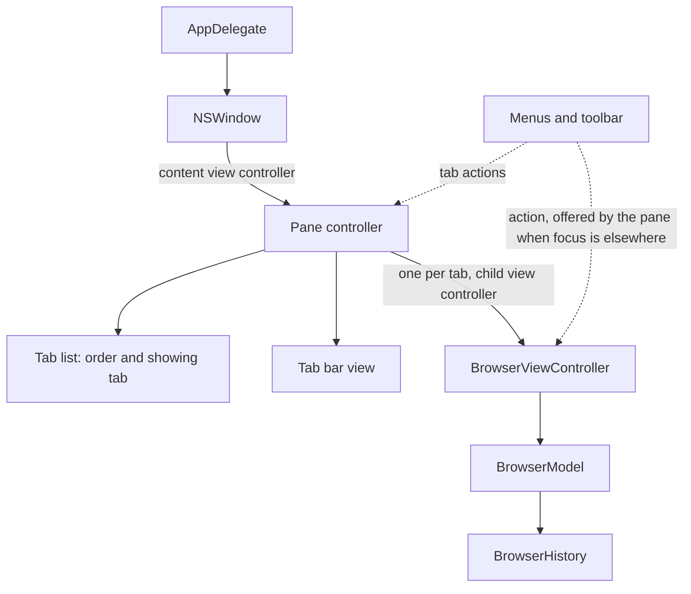
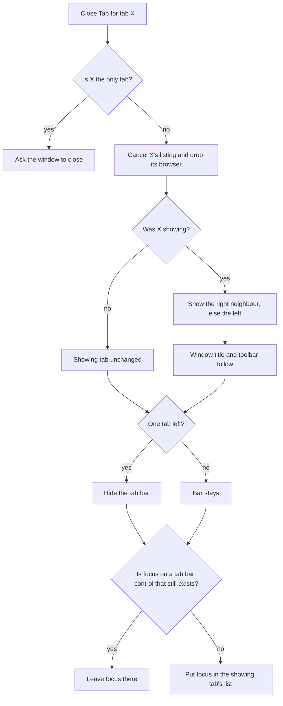

# Phase 1A Step 2 Tabs - Plan

## Goal Capsule

- **Objective:** Someone using Cairn can keep several folders open in one window as tabs, each remembering its own folder, history and selection, and can open, close and move between them with the keyboard, the menus or the mouse, with every tab control announced by VoiceOver.
- **Means:** A pane controller that owns an ordered list of tabs, a custom tab bar and one browser per tab, with tab commands sent through the responder chain like the Go commands (KTD1, KTD2, KTD3).
- **Authority:** R1 to R27 come from the step's brief and the step 2 row of `plans/phase-1a-browse.md`. Where a KTD and an R disagree, the R wins. Requirements marked "default" are unconfirmed bets listed under Assumptions; the user may change them without reopening the rest.
- **Execution profile:** New code in one Swift package (`BrowserUI`), small edits to the app target, a new end-to-end test file and three documents. Local `make uitest` cannot judge the accessibility-audit tests on the development Mac, so CI on the pull request is the only proof for them, and the macOS 15 workflow is the only proof for the minimum macOS.
- **Stop and tell the user when:**
  - the pull-request CI run or the manual macOS 15 run is red and the cause is not understood;
  - a second fix round is needed (a full CI run costs 50 to 60 billed minutes, a macOS 15 run 20 to 40);
  - the accessibility audit rejects the tab controls in a way that needs a different control structure than KTD9;
  - Control-Shift-Tab or Command-Shift-[ cannot be made to work as a menu shortcut;
  - a fix would need a change to `.github/workflows/` or `scripts/ci-select-xcode.sh`.
- **Who finishes:** The implementer lands U1 to U7 on branch `phase-1a/tabs`, runs the review and lessons steps, makes the one commit, opens the pull request, starts the macOS 15 run by hand and merges when both are green.

---

## Product Contract

### Summary

Phase 1A step 2 puts tabs inside the pane. Each tab is a complete browser. A custom tab bar shows the tabs when there are two or more, and menu commands with Finder's and Safari's shortcuts open, close and switch tabs. The Go commands and the toolbar's Back and Forward act on the tab that is showing.

### Problem Frame

After step 1 a window shows exactly one folder, and `App/AppDelegate.swift` gives the window one `BrowserViewController` as its whole content. Comparing or moving between two folders means navigating away and back. The milestone plan gives this step one line, "a custom tab bar inside the pane; each tab is its own browser", so most of the behavior below is filled in from Finder's and Safari's conventions and is marked as a default where the user has not confirmed it.

The tab bar is custom and sits inside the pane because the product is heading toward dual panes where each pane has its own tabs, which NSWindow's native window tabbing cannot do.

Two things in the current code assume one browser per window and have to move: `BrowserViewController` writes the window's title and takes keyboard focus itself, and the toolbar finds its browser by walking up from the window's content view controller, which will no longer be a browser.

### Requirements

**Tabs**

- R1. A pane holds one or more tabs. Each tab is its own browser with its own location, back and forward history and selection.
- R2. New Tab opens a tab at the end of the bar, selects it, and shows the folder the current tab is showing, with an empty history and nothing selected (default).
- R3. Close Tab removes the tab. If it was showing, the tab to its right is shown, or the tab to its left when there is none to the right (default). Closing a tab that is not showing leaves the showing tab alone.
- R4. Closing the last tab closes the window.
- R5. Show Next Tab and Show Previous Tab move one tab right or left and wrap around at the ends.
- R6. Showing a tab presents its browser as it was left: the same folder, selection, list position and Back and Forward state.
- R7. A tab that is not showing finishes a listing it had started, and never changes the window title, the toolbar or keyboard focus.
- R8. Closing a tab cancels a listing it has under way.

**Tab bar**

- R9. The tab bar is drawn by the app inside the pane, above the file list. NSWindow's native window tabbing is switched off for the app.
- R10. The bar shows one tab per browser in order, titled with the folder's name as the window title is today, and the title follows the tab as it navigates.
- R11. The showing tab is marked by more than color.
- R12. Each tab has a close button, and the bar has a New Tab button (default).
- R13. The bar is hidden while the pane has one tab (default).
- R14. The window's title is the showing tab's folder name.

**Commands**

- R15. The menus carry these commands (layout is a default):

  | Menu | Command | Shortcut |
  | --- | --- | --- |
  | File | New Tab | Command-T |
  | File | Close Tab | Command-W |
  | File | Close Window | Command-Shift-W |
  | Window | Show Previous Tab | Control-Shift-Tab, and Command-Shift-[ |
  | Window | Show Next Tab | Control-Tab, and Command-Shift-] |

- R16. Show Next Tab and Show Previous Tab are disabled while the pane has one tab.
- R17. Open, Back, Forward and Enclosing Folder, from the menu, the keyboard or the toolbar, act on the showing tab and are enabled by its state, wherever keyboard focus is in the window.
- R18. Command-W closes a key window that has no tabs, such as the About panel, as it does today.

**Keyboard and accessibility**

- R19. Every tab action can be done from the keyboard alone, and with Full Keyboard Access the tab bar's controls can be reached and pressed.
- R20. After the showing tab changes, keyboard focus is in the new tab's file list, unless focus was on a tab bar control that still exists, where it stays. Focus is never left on nothing.
- R21. Every tab bar control has an identifier and a spoken name set only through `AccessibilityElement` and its helpers. A tab speaks its folder name and whether it is the showing tab, and a close button says which tab it closes. The system accessibility audit passes on a window that shows the tab bar.

**Standing rules**

- R22. No file-system call runs on the main thread.
- R23. Nothing newer than macOS 15 is used without `#available` and a macOS 15 fallback.
- R24. A tab command changes the tab list as it arrives and leaves only the listing to a task, so the same command sent twice in a row does what two commands should.

**Proof and delivery**

- R25. Unit tests cover the tab list, the tab bar and the pane, and end-to-end tests cover the commands, the shortcuts and the tab bar in the running app.
- R26. `README.md`, `CLAUDE.md` and `ARCHITECTURE.md` describe the app as it is after this step.
- R27. The step lands as one commit named `Phase 1 step 2: tabs` on `phase-1a/tabs`, through a pull request merged only when CI is green.

### Scope Boundaries

Out of scope for this step:

- Fast first rows, live updates and the other view modes (steps 3 to 7). A tab that is not showing does not notice changes on disk; it shows what it last listed.
- The sidebar and the path bar (steps 8 and 9), which will act on the showing tab.
- Saving and restoring tabs across a quit (step 10). KTD2 names what step 10 will save.
- Dual panes. This step has one pane per window and no notion of an active pane.
- Dragging a tab to reorder it, to another window or out into a new window, and dropping files on a tab.
- Opening a folder in a new tab (Command-double-click, a File menu command or a context menu).
- Command-1 to Command-9, Close Other Tabs, reopening a closed tab, a tab context menu, pinned tabs and a tab overview.
- A Show Tab Bar command. The bar's visibility follows the tab count only.

Considered and not built:

- Scrolling or an overflow menu for more tabs than fit. Tabs share the bar's width and shrink to a minimum; past that the rightmost are clipped and stay reachable by keyboard. The user sees this at once and it is cheap to add later. A report of someone working with that many tabs would change the call.
- Arrow-key movement between tabs inside the bar and a VoiceOver "close" action on the tab itself. Full Keyboard Access reaches every tab and close button with Tab, and every action has a menu command. Feedback from a VoiceOver or keyboard-only user would change the call.
- A spoken announcement when the showing tab changes. The window's title changes and the tab reports its state, which is what Finder offers.
- Telling same-named tabs apart, with a path in the title or a tooltip. Finder shows the name alone.
- A confirmation before closing a window with several tabs.

#### Deferred to Follow-Up Work

- A New Window command, and reopening a window after the last one closes. Today the app keeps running with no window and no way to make one, and Command-T is disabled there. This predates the step and wants its own decision before step 10 restores windows.
- The Liquid Glass look for the tab bar on macOS 26, behind `#available`. This step draws the bar the same way on every macOS.

---

## Planning Contract

### Key Technical Decisions

- KTD1. **One `BrowserViewController` per tab, kept alive; only the showing tab's view is in the window.** Each tab keeps its model, table, scroll position and load task, so R6 and R7 need no save-and-restore code, and steps 5 to 7 change one browser without knowing about tabs. A browser's view loads its folder in `viewDidLoad`, so a tab that has never been shown does no listing, which is what step 10 wants for restored tabs. The alternative, one list view re-pointed at a different model per tab, loses the scroll position and has to re-bind every later view mode. The choice was made by judgment: both were understood well enough, and reversing it stays inside the pane controller.
- KTD2. **Tab order and the showing tab live in a small value type with no AppKit in it**, as `BrowserHistory` does for history. It owns every rule in R2 to R5: where a new tab goes, which tab shows after a close, wrapping, and what happens on the last tab. It is generic over a tab identity so the tests need no views. It is also the thing step 10 will save, beside each tab's location.
- KTD3. **A pane view controller owns the tab list, the tab bar, the browsers as child view controllers, the window title and keyboard focus.** It becomes the window's content view controller. Dual panes later put two of them under a parent. It creates every browser with the same `DirectoryReading`, so tests inject `StubReader` once.
- KTD4. **Commands still travel the responder chain to the showing browser, and the pane offers that browser when focus is outside it.** With focus in the file list the chain already passes the browser. With focus on a tab bar control, on a toolbar button, or on nothing, it does not: the pane answers `supplementalTarget(forAction:sender:)` with the showing browser, and `ToolbarButtonItem.responder(to:from:)`, which walks the chain by hand for macOS 15, learns to ask each responder for that offer. A probe on macOS 27 confirmed the hand-written walk from a button beside the browser finds nothing today.
- KTD5. **The tab actions are named `newTab`, `closeTab`, `showNextTab` and `showPreviousTab`.** `NSWindow` itself implements `selectNextTab(_:)`, `selectPreviousTab(_:)` and `toggleTabBar(_:)` for native window tabbing (probe, macOS 27). A menu item using one of those names would reach the window whenever the chain misses the pane and silently do nothing.
- KTD6. **`BrowserViewController` gives up the window.** It stops writing the window's title and stops taking focus when it appears. It reports a title change to its owner as the move is made, and offers a way to put focus in its list and to cancel its load. The pane cannot lean on `viewDidAppear` for this: a probe showed a child's `viewDidAppear` arrives on a later turn of the run loop after its view is added, so the pane sets focus and validates the toolbar itself, in the command.
- KTD7. **Shortcuts are menu key equivalents, with the second shortcut of each pair on a hidden item.** Show Previous Tab's key is the back-tab character (U+0019) with Control and Shift. A probe with made-up key events showed an item keyed as Tab with Control and Shift does not fire for back-tab and, listed first, steals plain Control-Tab. Command-Shift-[ and Command-Shift-] are hidden items that allow their key equivalent while hidden, keyed `{` and `}`; the probe showed `{` with Command does not fire Back's `[`.
- KTD8. **Command-W is one item that sends `closeTab`.** The pane handles it (R3, R4). The app delegate handles it at the end of the chain by closing the key window, which keeps R18 true. Window > Close goes away; File > Close Window sends `performClose` with Command-Shift-W.
- KTD9. **Tab bar controls are real buttons, side by side.** A tab is a button that reports a tab role and a selected value; its close button is a sibling, not a child, so Full Keyboard Access and VoiceOver reach both. A tab takes its identifier through `applyIdentifier(of:)` and speaks its own title, as a list cell does. The close button's spoken name is built from its element and the tab's title by a helper in `Accessibility.swift`, the only file allowed to set a label. Tab titles use the primary label color in every state: `docs/solutions/2026-10-09-accessibility-notes.md` records a dimmer color failing the contrast audit.
- KTD10. **Native window tabbing is switched off at launch**, so the system adds no tab commands of its own with the same shortcuts and never merges Cairn windows into system tabs.
- KTD11. **New end-to-end assertions share launches.** Each app launch adds to the billed run, so the tab scenarios are grouped into four tests instead of one per behavior.

### High-Level Technical Design

Who owns what after this step. Solid arrows are ownership; the dotted arrow is the responder chain.

What Close Tab does, all in the command, before any task runs:

### Assumptions

Unconfirmed bets made without a user present. Each is a default the user can change.

- **New tab's folder (R2):** the folder the current tab is showing. Finder instead opens its "new windows show" folder. Choosing the launch folder changes one rule in the pane and two test scenarios.
- **New tab's position (R2):** the end of the bar, as Command-T does in Safari. "Beside the current tab" changes one rule in the tab list.
- **Tab shown after a close (R3):** the right neighbour, else the left. Safari returns to the tab last used; that needs the tab list to remember an order of use.
- **Last tab (R4):** Command-W closes the window and the app keeps running with no window, as today. Wanting a New Window command or a window on Dock click adds a unit (see Deferred to Follow-Up Work).
- **Menu layout (R15):** Finder's File and Window placement, with fixed titles. Finder renames Close Tab to Close Window when one tab is left; this plan does not.
- **Hidden with one tab (R13):** and no Show Tab Bar command. An always-visible bar or a toggle adds a View menu item and a saved preference.
- **New Tab button (R12):** present at the bar's trailing end, as in Finder and Safari. It is only visible when the bar is.
- **Tab title (R10):** the folder name alone, with no icon and nothing to tell two same-named folders apart.
- **Too many tabs:** tabs shrink to a minimum width and then clip (see Considered and not built).
- **Keyboard reach (R19):** menu commands plus Full Keyboard Access count as "operable from the keyboard". There is no arrow-key movement inside the bar.
- **Focus rule (R20):** switching tabs by a menu command or a mouse click puts focus in the file list; pressing a focused tab with Space leaves focus on the tab.
- **Appearance:** system colors and the same drawing on macOS 15, 26 and 27.
- **Keyboards:** Command-Shift-[ and Command-Shift-] are keyed for layouts where those are `{` and `}`, as Safari's are. Control-Tab works on every layout.
- **Scope of edits:** changing how `BrowserViewController` handles the window title and focus (KTD6), teaching `ToolbarButtonItem` to follow offers (KTD4) and removing Window > Close (KTD8) are in scope because R14, R17 and R18 depend on them.
- **Quality bar:** the step 2 row of `plans/phase-1a-browse.md` has no quality bar, and the Claude Doc that might hold more detail could not be read during planning. R1 to R27 are assumed to be the whole of it.
- **Research:** no outside research was done. AppKit behavior was checked with small probes on macOS 27 only.

### Risks

| Risk | Consequence | Response |
| --- | --- | --- |
| The audit of a window with the tab bar cannot be judged on the development Mac, and may object to the tab role, the close button's size or a truncated title. | A CI fix round, 50 to 60 billed minutes. | Keep the audit fixture's folder names short. Read a finding with `issue.element?.debugDescription`. Change the control, not the audit, unless the finding is about system chrome. A structure change is a stop condition. |
| macOS 15 answers responder-chain questions differently: step 1 found `NSApp.target(forAction:to:from:)` returning nothing for a window that is not key. | Unit tests pass locally and on CI and fail on macOS 15. | Every pane and toolbar test that asks who handles an action also runs the path with no application to ask. The macOS 15 workflow is run by hand before the merge. |
| Whether AppKit asks a view controller for `supplementalTarget` could not be shown by a probe, because a process started from a shell cannot get a key window. | Back with focus on a tab button does nothing under Full Keyboard Access. | It is documented AppKit behavior and the toolbar button already relies on it. U4's manual check with Full Keyboard Access on confirms it before the push. |
| The real Control-Shift-Tab key event may differ from the made-up events in the probe. | Show Previous Tab's first shortcut does not fire. | The end-to-end test presses the real keys. Command-Shift-[ covers the command if it fails; a shortcut that cannot be made to work is a stop condition. |
| How XCUITest classifies a custom tab control is unknown. | The end-to-end queries find nothing. | Query by the declared identifiers across element types first, and narrow the type once it is seen. `make uitest` shows this locally. |
| Four more launches and one more audit lengthen the UI suite. | The CI run crosses a billing step, or the macOS 15 run nears its monthly limit. | KTD11. Read the run's printed duration after the first push and tell the user if a full run now bills more than 60 minutes. |
| Tests written against `viewDidAppear` timing. | Flaky unit tests. | KTD6: the pane acts in the command, and tests assert state straight after the command. |

---

## Implementation Units

U1, U2 and U3 are independent. U4 needs all three, U5 needs U4, U6 needs U5, and U7 comes last.

### U1. The tab list

- **Goal:** One tested place for the order of tabs, which one is showing, and the rules for adding, closing and moving between them.
- **Requirements:** R2, R3, R4, R5, R24, R25
- **Dependencies:** None
- **Files:**
  - `Packages/BrowserUI/Sources/BrowserUI/TabList.swift` (new)
  - `Packages/BrowserUI/Tests/BrowserUITests/TabListTests.swift` (new)
- **Approach:** Apply KTD2. Every change is synchronous and reports what changed, so the pane can act on the answer in the same turn. Closing the only tab reports that it was the last and leaves the list as it is; the pane closes the window.
- **Patterns to follow:** `BrowserHistory` and `BrowserHistoryTests` for a `Sendable`, `Equatable` value type with mutating functions that return what happened.
- **Test scenarios:**
  - A new list has one tab and it is showing.
  - Adding a tab to a list of two puts it third and shows it.
  - A list can be built with several tabs and a showing position, and a position out of range falls back to the nearest valid one.
  - With tabs a, b, c and b showing, closing b shows c. With c showing, closing c shows b.
  - With a, b, c and c showing, closing a leaves c showing. With a showing, closing c leaves a showing.
  - Closing the only tab reports "last tab" and the list still holds it.
  - Next from the last tab shows the first; previous from the first shows the last.
  - With one tab, next and previous report no change.
  - Showing a tab by identity works; an unknown identity or the tab already showing reports no change.
  - Closing a tab by an unknown identity reports no change.
- **Verification:** The rules in R2 to R5 are each stated once, here, and no AppKit type appears in the file.

### U2. The browser gives up the window

- **Goal:** A browser can live in a tab: it does not write the window's title or take focus by itself, tells its owner when its title changes, and can be told to take focus or to stop loading.
- **Requirements:** R7, R8, R10, R14, R20, R25
- **Dependencies:** None
- **Files:**
  - `Packages/BrowserUI/Sources/BrowserUI/BrowserViewController.swift`
  - `Packages/BrowserUI/Tests/BrowserUITests/BrowserViewControllerTests.swift`
- **Approach:** Apply KTD6. The controller keeps setting its own `title`. The static `title(for:)` stays the one rule for a folder's display name, so a tab's title can be read from its location without loading its view.
- **Patterns to follow:** `model.onChange` for a single owner callback; `StubReader` and `Gate` for a held listing; `backSentTwiceBeforeTheFirstStartsStillShowsThePreviousFolder` for asserting straight after a command.
- **Test scenarios:**
  - Opening a subfolder reports the new title as the command is handled, while the subfolder's listing is still held at a gate.
  - Back with no history reports nothing.
  - A browser whose view sits in a window beside another view, with that view as first responder, opens a folder and finishes loading: the window's title and first responder are unchanged.
  - Asked to take focus while in a window, the browser's file list becomes first responder.
  - With a listing held at a gate, cancelling the load cancels the task, and opening the gate afterwards changes nothing in the model.
  - Every existing test in `BrowserViewControllerTests` and `BrowserToolbarTests` passes without edits to its assertions.
- **Verification:** `BrowserViewController.swift` touches `view.window` only to validate the toolbar and, when asked, to put focus in its list. It never sets the window's title.

### U3. Tab bar view and its accessibility elements

- **Goal:** A view that draws a row of tabs from a list of titles and reports clicks, with every control declared.
- **Requirements:** R9, R10, R11, R12, R19, R21, R25
- **Dependencies:** None
- **Files:**
  - `Packages/BrowserUI/Sources/BrowserUI/TabBarView.swift` (new)
  - `Packages/BrowserUI/Sources/BrowserUI/Accessibility.swift`
  - `Packages/BrowserUI/Tests/BrowserUITests/TabBarViewTests.swift` (new)
  - `Packages/BrowserUI/Tests/BrowserUITests/AccessibilityTests.swift`
- **Approach:**
  1. Declare four elements in `AccessibilityElement.all`: the bar, a tab, a close button and the New Tab button. Identifiers are lowercase words joined by hyphens, as the existing test requires, so tabs share one identifier the way list cells do.
  2. Apply KTD9. The bar knows nothing about browsers: it is given identities, titles and which is showing, and calls back with "show", "close" or "new".
  3. An update changes existing tab controls in place and only adds or removes controls for tabs that came or went, so a control that has focus keeps it (R20).
- **Patterns to follow:** `NSToolbarItem(_:symbolName:)` in `Accessibility.swift` for a helper that builds a button's identity from an element; `ToolbarButton` for an image-only button with a label; `theBrowserUsesDeclaredElementsForEveryControl` for walking a view tree.
- **Test scenarios:**
  - The four elements are in `AccessibilityElement.all`, so the uniqueness and label test covers them.
  - Given titles "Documents", "Sub", "Sub" with the second showing, the bar holds three tab buttons in that order, each with the tab identifier and its own title as spoken text.
  - Only the second tab reports itself selected, and its role is a tab's.
  - Each tab has a close button with the close identifier whose spoken name contains its tab's title.
  - The New Tab button has its declared identifier and label.
  - A tab titled "/" shows and speaks "/".
  - A title too long to fit is still spoken in full.
  - After an update that renames the first tab and shows the third, the same three button objects are present with the new title and selected state.
  - After an update that removes the second tab, the first and third button objects are the ones that were there before.
  - Pressing a tab reports "show" with that tab's identity; pressing its close button reports "close" with it; pressing New Tab reports "new".
  - Tab titles use the primary label color whether showing or not.
  - Every identifier found in the bar's view tree is declared, AppKit's own underscore-prefixed ones aside.
- **Verification:** `scripts/check-accessibility.sh` passes with no change to the script, and `TabBarView.swift` sets no identifier or label directly.

### U4. The pane: tabs, commands, focus and the showing browser

- **Goal:** A view controller that holds the tabs of one pane and makes R1 to R8, R13, R14, R16, R17 and R20 true.
- **Requirements:** R1, R2, R3, R4, R5, R6, R7, R8, R13, R14, R16, R17, R19, R20, R22, R23, R24, R25
- **Dependencies:** U1, U2, U3
- **Files:**
  - `Packages/BrowserUI/Sources/BrowserUI/PaneViewController.swift` (new)
  - `Packages/BrowserUI/Sources/BrowserUI/BrowserToolbar.swift`
  - `Packages/BrowserUI/Tests/BrowserUITests/PaneViewControllerTests.swift` (new)
  - `Packages/BrowserUI/Tests/BrowserUITests/BrowserToolbarTests.swift`
  - `Packages/BrowserUI/Tests/BrowserUITests/AccessibilityTests.swift`
- **Approach:**
  1. Apply KTD1 and KTD3. Browsers are added and removed with view-controller containment, so `viewDidAppear` and `viewDidDisappear` stay truthful for step 4.
  2. Each tab action changes the tab list first, then swaps views, sets the window title, validates the toolbar and applies R20, all before returning. A new tab reads its folder from the current browser's model in the same turn, so it follows a move whose listing has not started.
  3. The pane validates its four actions through `NSUserInterfaceValidations`, the method the Go menu uses.
  4. Apply KTD4 in the pane and in `ToolbarButtonItem.responder(to:from:)`.
- **Execution note:** Write the "sent twice with no await" tests first, as `docs/solutions/2026-10-10-check-then-act-across-a-task-boundary.md` asks. Before polishing, turn on Full Keyboard Access on the development Mac and check by hand that Tab reaches the tab bar from the list and that Command-[ works with focus on a tab; if Tab does not reach the bar, the window's key-view loop needs setting up in U5.
- **Patterns to follow:** The command handlers in `BrowserViewController` (synchronous move, then `run`); `ToolbarButton.supplementalTarget(forAction:sender:)`; `browserWindowWithHistory` in `BrowserToolbarTests` for a window with the real toolbar; `withNoApplicationToAskTheWindowsContentIsStillFound` for the macOS 15 path.
- **Test scenarios:**
  - A new pane has one tab, a hidden tab bar, and its browser's view in the pane.
  - New Tab gives two tabs with the second showing, at the first tab's folder, with no history; the bar is visible; the first browser's view is out of the window and the second's is in.
  - Open on a selected folder followed by New Tab with no await between: the new tab is at the opened folder.
  - New Tab twice with no await between: three tabs, the third showing, and every tab ends loaded.
  - In tab 2 open a subfolder and select an item; show tab 1: its folder, its table's selected row and its Back state are as they were. Show tab 2: the subfolder, its selected row and Back enabled.
  - Show Next Tab from the last tab shows the first. Sent twice with three tabs and no await, it moves two tabs.
  - Show Next Tab and Show Previous Tab validate as disabled with one tab and enabled with two; Close Tab and New Tab validate as enabled.
  - Close Tab on the middle of three tabs shows the right neighbour, and the closed tab's listing, held at a gate, is cancelled.
  - Closing down to one tab hides the bar.
  - Close Tab twice with two tabs and no await: one tab is closed and the window is asked to close exactly once.
  - Closing a tab that is not showing, through the bar, leaves the showing browser and its view in place.
  - The window title is the showing tab's folder name after New Tab, after a switch, after a close and after the showing tab navigates.
  - A tab left while its listing is held at a gate finishes loading after the switch: the window title and first responder do not change, and its tab title was already right.
  - With focus in the list, Show Next Tab puts focus in the new tab's list.
  - With focus on a tab's button, pressing it leaves focus on that button.
  - Close Tab with focus in the closing tab's list puts focus in the surviving tab's list, never on the window.
  - Pressing a focused close button puts focus in the showing tab's list.
  - The pane offers the showing browser for Back, Forward, Enclosing Folder and Open, offers the other browser after a switch, and offers nothing for an unrelated action.
  - With tab 1 at a folder with no history and tab 2 one folder in, and focus on a tab button: the toolbar's Back is disabled on tab 1 and enabled straight after showing tab 2, with the application asked and with no application to ask.
  - A toolbar button that has focus offers the showing browser as the target of Back.
  - Every identifier found in the pane's view tree, with two tabs, is declared.
- **Verification:** Each "twice with no await" test is seen to fail once against a version that changes the tab list inside a task. No path leaves the window as its own first responder after a tab action.

### U5. The app: window content and menus

- **Goal:** The app's window holds a pane, and the menus carry the tab commands with their shortcuts.
- **Requirements:** R9, R15, R16, R18, R19
- **Dependencies:** U4
- **Files:**
  - `App/AppDelegate.swift`
  - `App/MainMenu.swift`
- **Approach:**
  1. The window's content view controller becomes the pane, opened at the launch folder. The window still takes its identifier from `.mainWindow`.
  2. Apply KTD10 before the window is made.
  3. Apply KTD7 and KTD8 in `MainMenu`, and add the end-of-chain `closeTab` to the app delegate with validation that needs a key window.
- **Execution note:** The app target has no unit tests, so run `HistoryTests` and `BrowsingTests` locally as soon as the window holds a pane; they prove the title, focus at launch and the Go commands survived the move before any tab test exists.
- **Patterns to follow:** The Go menu in `App/MainMenu.swift` for items with no target; `enclosingFolder.keyEquivalentModifierMask` for a non-default modifier.
- **Test scenarios:** Covered end to end in U6: every row of R15, R16's enabled states, R18 on the About panel, and the absence of system tab commands in the Window menu.
- **Verification:** Every existing end-to-end test passes unchanged. With one tab the app looks and behaves as it did after step 1.

### U6. End-to-end tests

- **Goal:** The running app proves the commands, the shortcuts, the tab bar and its accessibility.
- **Requirements:** R1 to R21, R25
- **Dependencies:** U5
- **Files:**
  - `UITests/TabsTests.swift` (new)
  - `UITests/AccessibilityTests.swift`
- **Approach:** Apply KTD11. Three tests in `TabsTests` and one audit test, each one launch. Tabs, close buttons and the bar are found by `AccessibilityElement` identifiers. A menu's enabled items are read with the menu open, as `HistoryTests.enabledGoMenuItems` does.
- **Patterns to follow:** `UITests/HistoryTests.swift` for the launch helper, the fixture tree, row selection and menu reading; `AccessibilityTests.audit` for the audit with its counted retry.
- **Test scenarios:**
  - Tabs keep their own folder, history and selection. At launch no tab bar exists, and Window > Show Next Tab and Show Previous Tab are disabled. Command-T: the bar exists with two tabs titled with the launch folder's name, the second selected, and both Window items are enabled. Double-click `Sub`: the second tab and the window are titled `Sub` and the toolbar's Back is enabled. Control-Tab: the launch folder's rows show, Back is disabled, the window has the launch folder's name; click `alpha.txt`. Control-Shift-Tab: `inner.txt` shows. Command-[: the launch folder shows in tab 2 with `Sub` selected. Command-Shift-]: tab 1 shows with `alpha.txt` still selected. Command-Shift-[: back on tab 2.
  - Closing tabs, with the mouse where it matters. Open the About panel from the menu and press Command-W: the panel closes and the main window remains. Command-T, then click the New Tab button: three tabs. Click the first tab: its rows show and it is selected. Click the third tab's close button: two tabs remain and the first is still selected. Command-W: one browser remains, the tab bar is gone, and Down Arrow selects a row, which shows the list has focus. Command-W: the app has no window. The Window menu never showed an item the app did not add.
  - Tabs from the keyboard alone, in `AccessibilityTests`. With no mouse: Command-T, Down Arrow to `Sub`, Command-O; Control-Tab; Down Arrow selects the first row of tab 1; Command-W closes tab 1 and `inner.txt` is showing; Command-Up shows the launch folder.
  - The audit passes with two tabs showing. Launch, Command-T, check the bar's label and that the selected tab reports itself selected, run the audit as "Two tabs". Only CI can judge this.
  - Every existing test in `UITests/` passes unchanged.
- **Verification:** `make uitest` passes locally for everything but the audit tests. The four new tests add four launches and one audit, no more.

### U7. Documents match the finished step

- **Goal:** The repository's documents describe the app as it is after U1 to U6.
- **Requirements:** R26
- **Dependencies:** U1 to U6, and the review step's fixes
- **Files:**
  - `ARCHITECTURE.md`
  - `README.md`
  - `CLAUDE.md`
- **Approach:**
  1. `ARCHITECTURE.md`: add the pane, the tab list and the tab bar to the `BrowserUI` row; rewrite step 1 of "How a folder gets on screen" for the pane; say that the pane owns the window title and focus and offers the showing browser to the responder chain; take tabs out of "What is not here yet".
  2. `README.md`: the status paragraph says the app has tabs.
  3. `CLAUDE.md`: the Status section says step 2 is done and step 3 is next.
- **Test expectation:** none -- documents only. `make lint` runs the governance check over them.
- **Verification:** Each document names only code that exists. The lessons note for the step is written by the lessons step, not here.

---

## Verification Contract

| Gate | Where | Proves | Notes |
| --- | --- | --- | --- |
| `make lint` | Local, then CI | Governance files and Swift formatting | Formatting is strict. |
| `make test` | Local, then CI | Unit tests for U1 to U4, the accessibility convention check, the main-thread and boundary checks | Use `rtk proxy make test` to capture full output in a Claude Code session. |
| `make uitest` | Local | `TabsTests`, the keyboard-only test, `HistoryTests` and `BrowsingTests` | The accessibility-audit tests time out on the development Mac (macOS 27) on `main` as well, so a local timeout there is not a finding. |
| By hand, Full Keyboard Access on | Local | Tab reaches the tab bar, Space presses a tab, Command-[ works with focus on a tab | The only proof of KTD4's offer inside a key window. |
| Pull-request CI on `macos-26` | GitHub | Everything above plus the four audit tests | One run, 50 to 60 billed minutes. Watch it with `gh run watch`. |
| macOS 15 workflow, started by hand | GitHub, before the merge | Runtime behavior on the minimum macOS | `gh workflow run macos-15.yml --ref phase-1a/tabs`, 20 to 40 billed minutes. Start it on the same pushed commit as the pull-request run. |

Review fixes, the lessons note and the document updates are finished locally before the first push: any later push, even of documents only, starts another full run. Before the push, each new test from U1 to U4 is seen to fail once against code that lacks the behavior, so no new test passes without checking anything.

---

## Definition of Done

- U1 to U7 are complete, and every scenario listed under them exists as a test.
- R23 holds by the build: the deployment target is 15.0 with warnings as errors, so the compiler rejects an unguarded newer API.
- `make lint`, `make test` and the locally judgeable part of `make uitest` pass on the final tree.
- The manual Full Keyboard Access check has been done on the final tree.
- The review step has run over the whole step diff and its findings are fixed or answered.
- The lessons step has recorded what the step taught in `docs/solutions/`.
- No abandoned attempt remains in the diff: if a control structure or shortcut encoding was tried and dropped, only the kept one is present.
- The branch `phase-1a/tabs` holds one commit named `Phase 1 step 2: tabs`.
- A pull request is open, its CI run is green, the macOS 15 run started by hand on the same commit is green, and it is merged only then.
- The pull request's diff touches nothing under `.github/workflows/` and not `scripts/ci-select-xcode.sh`.

---

## Sources

- `plans/phase-1a-browse.md`, the step 2 row and the later steps this one must leave room for.
- `docs/solutions/2026-10-10-check-then-act-across-a-task-boundary.md`: a command moves state as it arrives and leaves the listing to the task; test by sending it twice with no await.
- `docs/solutions/2026-10-09-navigation-history-notes.md`: view-based toolbar items are validated by hand, the macOS 15 difference in `NSApp.target(forAction:to:from:)`, and the advice to run the macOS 15 workflow before merging a step that leans on AppKit.
- `docs/solutions/2026-10-09-accessibility-notes.md`: declare an element for every control, add a new screen to the audit tests, a fixed label hides changing text, dim text fails the contrast audit, and how to read an audit finding on CI.
- `docs/solutions/2026-10-09-walking-skeleton-notes.md`: a window does not follow its controller's title, and view-controller tests await `loadTask`.
- `docs/solutions/2026-10-09-phase-0-follow-up-notes.md`: the UI test runner is sandboxed, and macOS 15 differences found only on its runner.
- `Packages/BrowserUI/Sources/BrowserUI/BrowserToolbar.swift`: `ToolbarButtonItem.handler`, `responder(to:from:)` and `ToolbarButton.supplementalTarget`, which KTD4 extends.
- Probes run while planning, in a throwaway Swift file outside the repository, on macOS 27:
  - `NSWindow` responds to `selectNextTab:`, `selectPreviousTab:` and `toggleTabBar:`, and not to `newTab:`, `closeTab:`, `showNextTab:` or `showPreviousTab:`.
  - A child view controller's `viewDidAppear` had not run straight after its view was added to a visible window and had run one run-loop turn later.
  - When the first responder's view is removed from the window, the window becomes its own first responder.
  - From a button beside the browser the responder chain is button, container view, pane controller, window, and a walk that only asks `responds(to:)` finds no handler for Back.
  - With made-up key events: an item keyed Tab with Control fires for Control-Tab; an item keyed back-tab with Control and Shift fires for Control-Shift-back-tab; an item keyed Tab with Control and Shift does not, and takes Control-Tab when it is listed first; an item keyed `{` with Command fires for Command-Shift-`{` and Back's `[` does not.
