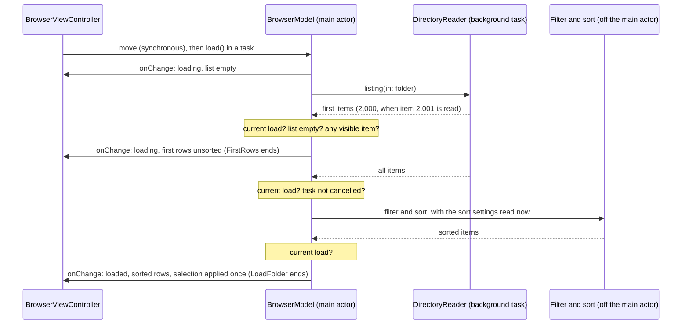

# Phase 1A Step 3 Fast First Rows - Plan

## Goal Capsule

- **Objective:** Someone who opens a large folder in Cairn sees rows at once and can act on them, then finds the list in its usual sorted order with the selection where they left it. On the reference Mac the first rows of a 10,000-item folder are on screen within 200 ms (quality bar 4). A small folder looks exactly as it does today.
- **Means:** The reader hands over the first items before the rest, the model publishes them unsorted and then publishes the sorted list, and the filtering and sorting of the whole folder move off the main actor (KTD1, KTD4, KTD6).
- **Authority:** R1 to R22 come from the step's brief and from `plans/phase-1a-browse.md` ("Fast first rows (step 3)" and the step 3 row). Where a KTD and an R disagree, the R wins. Requirements marked "default" are unconfirmed bets listed under Assumptions; the user may change one without reopening the rest.
- **Execution profile:** Changes in two Swift packages (`FileSystemCore`, `BrowserUI`), one Python script with its self-test, one new end-to-end test, the performance test and four documents. Three proofs need the user at the development Mac, because UI automation there asks for an authentication prompt: `make uitest`, `make perf` and a VoiceOver check. The 200 ms judgment can only be made there, because that Mac is the reference Mac.
- **Stop and tell the user when:**
  - UI automation is needed and the authentication prompt has not been approved: ask, and do not push until `make perf` has judged the target;
  - `make perf` on the reference Mac reports the target missed;
  - the VoiceOver check fails expectation 1 or 2 under U6;
  - a unit test of U4 fails on macOS 15 or macOS 26 only, which means AppKit differs there from the probe on macOS 27;
  - the pull-request CI run or the manual macOS 15 run is red and the cause is not understood, or a second fix round is needed (a full run costs about 80 billed minutes, a macOS 15 run about 50);
  - a fix would need a change under `.github/workflows/`.
- **Who finishes:** The implementer lands U1 to U7 on branch `phase-1a/fast-first-rows`, runs the review and lessons steps, makes the one commit, opens the pull request, starts the macOS 15 run by hand and merges when both are green.

---

## Product Contract

### Summary

Phase 1A step 3 changes how a folder reaches the list. A folder of more than 2,000 items shows its first 2,000 items unsorted as soon as they are read, and the list settles into sorted order when the whole folder has been listed and sorted in the background. A smaller folder is shown once, sorted, as today. `make perf` gains a target check that fails on the reference Mac when the first rows of a 10,000-item folder take more than 200 ms.

### Problem Frame

The committed baseline (`docs/performance/baseline.json`) records 0.266 s from the request to load until a 10,000-item folder has rows, against a 200 ms target. `BrowserModel.load()` waits for the whole listing (54 ms), then filters and sorts on the main actor (144 ms), and only then tells the view. At 100,000 items the sort alone holds the main actor for about 2 s, so the window cannot respond while a large folder opens.

`DirectoryReader.items(in:)` returns the whole folder at once, so the model has nothing to show earlier. The `LoadFolder` signpost interval that the performance test measures ends after the sort, so it cannot measure first rows once they arrive earlier than the sorted list.

Showing rows twice instead of once touches rules that steps 1 and 2 established: a remembered selection is restored by name when a listing arrives, a slow listing of a folder the user has left must not overwrite the current one, a command changes state as it arrives, a tab that is not showing never touches the window, and closing a tab cancels its listing.

### Requirements

**First rows**

- R1. When a folder is opened, its first batch of rows is shown, unsorted, as soon as that batch has been listed. The app waits for neither the rest of the listing nor the sort.
- R2. The whole folder is filtered and sorted off the main thread while the first rows are on screen. The list then settles into the same order it has today.
- R3. A folder small enough to arrive as one batch is shown once, already sorted: no unsorted rows, no second reload, the same change notifications as today.
- R4. Reloading the folder already showing keeps its rows until the sorted result replaces them. First rows are shown only into an empty list (default).
- R5. The first rows can be used: selected, opened, scrolled (default).

**Between the first rows and the sorted list**

- R6. A selection remembered by the history is restored exactly once, when the list settles. It is not applied to the first rows and it is not lost.
- R7. A selection the user makes in the first rows stays on the same items when the list settles, is brought into view, and replaces a remembered selection (default).
- R8. With nothing selected, the list keeps its scroll offset when it settles (default). Rows do not animate into place (default).
- R9. Keyboard focus does not move because rows arrive or settle.
- R10. VoiceOver does not hear the list announced twice and does not lose its place: the app posts no announcement for either arrival, and the item under the VoiceOver cursor is found again through the selection.

**Loads that end early**

- R11. A load that has been superseded publishes nothing more, whichever stage it had reached: before the first rows, during the listing, or during the sort.
- R12. A cancelled load publishes nothing more and stops its listing and its sort. Closing a tab cancels its load.
- R13. A listing that fails, also after its first rows were shown, clears the rows and shows why, as a failed listing does today (default for the part-way case).
- R14. The rules of steps 1 and 2 hold with two arrivals instead of one: a command changes history and pending selection as it arrives, and a tab that is not showing finishes its load without touching the window's title, the toolbar or keyboard focus.

**Performance proof**

- R15. The time to first rows is measured from the request to load until the first batch has reached the list.
- R16. `make perf` fails on the reference Mac when the time to first rows for a 10,000-item folder is above 200 ms. On any other Mac, the CI runner included, it reports the time without judging it.
- R17. A target that was not measured, or was measured from a different interval, fails on the reference Mac instead of passing silently.
- R18. The 100,000-item case gets measurements and no target (default).

**Standing rules and proof**

- R19. No file-system call runs on the main thread, and every file-system entry point keeps its guard.
- R20. Unit tests for the reader and the model use deterministic stubs and hooks. No unit test asserts on wall-clock time.
- R21. The existing unit tests that expect sorted `items` after `load()` pass unchanged.
- R22. `ARCHITECTURE.md`, `README.md`, `CLAUDE.md` and `docs/performance/README.md` describe the app as it is after this step. The step lands as one commit named `Phase 1 step 3: fast first rows` on `phase-1a/fast-first-rows`, through a pull request merged only when CI is green.

### Success Criteria

- On the reference Mac, `make perf` reports the first-rows target met.
- With a 100,000-item folder open in the app, the window responds to a click or a key press while the list is still unsorted.

### Scope Boundaries

Out of scope for this step:

- Live updates (step 4). R4 is the only behavior this step defines for a reload.
- Sortable columns, the folders-first option and type-to-select (step 5). `NSTableView.allowsTypeSelect` is on by default, but a view-based table types-to-select only when its delegate supplies the text, and `BrowserViewController` does not. A selection made that way will be an ordinary user selection under R7.
- Slow volumes. The first batch is counted in items, not in time, so a network share that lists slowly shows its first rows late. Network and cloud locations get their own treatment later in Phase 1.
- Storing an item's name in `FileItem`. KTD7 extracts names once per sort instead.

Considered and not built:

- Rows appended batch by batch while the listing runs. Two arrivals already meet R1 and R2. More arrivals mean more reloads and more for VoiceOver to track, and each would show a list that is neither complete nor sorted. A report that a very large folder looks stuck at 2,000 rows would change the call.
- A time-based first batch ("whatever was read in 16 ms"). It adapts to slow disks but cannot be tested without a clock (R20).
- Animating rows into their sorted places. Up to 2,000 rows would move while thousands more are inserted.
- Dimming or disabling the first rows until the list settles. It would withdraw R5, which is the point of showing them.
- A spoken "N items" announcement when a folder settles. Nothing is announced today, and R10 asks for less speech, not more.
- Guarding a double-click that straddles the settle (see Risks). With KTD7 the unsorted rows are on screen for about 65 ms at 10,000 items. A report of a wrong folder opening would change the call.
- A second measured interval in the UI test for the whole load. XCTest prints one line per metric under the same test name and `scripts/performance.py` keys results by test name, so it needs a parser change; the package-level tests already time the listing and the sort.
- A time-to-first-rows test in the app at 100,000 items (KTD15).
- Wrapping the table's reload in the flag that guards programmatic selection. A probe showed `reloadData` clears the selection without notifying, and the existing reload tests would fail on any macOS where it does notify.

---

## Planning Contract

### Key Technical Decisions

- KTD1. **The reader hands over a stream of at most two events: the first items, then all items.** The first-items event is sent at most once and only when a further item has been read, so a stream with no first-items event means the whole folder fit in one batch (R3). The all-items event carries the complete listing, first items included, and is always last. The stream is produced by an unstructured task started from a nonisolated function, which a probe showed runs off the main thread and inherits the caller's priority and task-local values, so the main-thread guard's test handler still applies. Alternatives rejected:
  - A callback for the first batch beside the existing return value. The enumerator loop is synchronous and off the main actor, so the callback needs its own unstructured hop to the main actor, and nothing orders that hop against the function's return.
  - Two calls (first batch, then the rest). The folder would be enumerated twice, or the enumerator kept alive between calls behind a session object.
  - A stream of plain batches. The model could not tell a one-batch folder from the first batch of a large one without waiting for a second element.
- KTD2. **The first batch is 2,000 items.** Measured on the reference Mac (see Sources): 2,000 items are read in 9 ms, and a 2,000-item folder is listed and sorted in 16 ms, one frame at 60 Hz. Below that size unsorted rows could only flicker, so they are skipped. Above it the first rows arrive about 9 ms after the listing starts whatever the folder's size. At 24 points a row, 2,000 rows fill any display many times over, also after hidden items are removed. The number is a named constant separate from the cancellation interval. The earlier candidate, 256 to match the cancellation check, would show unsorted rows for folders that finish 2 ms later.
- KTD3. **`items(in:)` stays, as a convenience that reads the stream to its end.** Every existing caller and test keeps working: the reader tests, the listing performance tests, and two `BrowserUI` tests. It throws `CancellationError` when its task was cancelled, because a cancelled stream ends without throwing (KTD10).
- KTD4. **`BrowserModel.load()` stays one function that returns when the list has settled, and publishes up to twice on the way.** A test that awaits `load()` still sees sorted items (R21). While first rows are showing, `state` stays `.loading` and `items` holds them; no state case is added, because nothing but tests needs to tell first rows from sorted ones, and tests can read `items`.
- KTD5. **First rows are published only when the list is empty and the batch has at least one visible item.** A move empties the list as the command arrives, so every navigation qualifies; a reload does not (R4). A first batch made only of hidden items publishes nothing, so the list never reloads to empty.
- KTD6. **The first batch is filtered on the main actor; the whole folder is filtered and sorted in one nonisolated async function in `FileSystemCore`.** Filtering 2,000 items costs about 0.2 ms. The function follows the pattern `DirectoryReader.items(in:)` already relies on: a nonisolated async function leaves the caller's actor, and a unit test records the thread. The comparator checks for cancellation on every comparison, which a measurement showed costs nothing (47.5 ms against 46.2 ms for 10,000 items), so a cancelled sort stops at once (R12). The model reads `sort` and `showsHiddenFiles` when the listing completes.
- KTD7. **The sort extracts each name once and sorts positions, not items (default, see Assumptions).** Today the comparator rebuilds both names from their URLs on every one of about 187,000 comparisons for 10,000 items. Extracting names once and sorting an array of indexes gives the same order in 31 ms instead of 181 ms at 10,000 items and 0.40 s instead of 3.0 s at 100,000. This shortens the time unsorted rows are on screen, which is what R7 to R10 have to cover.
- KTD8. **One rule decides what is selected when the list settles: what the user has selected since the move, or else what was remembered.** The same rule decides what the history remembers when a folder is left before it settles. The remembered selection stays pending through the first-rows publish and is consumed by the settled publish only (R6).
- KTD9. **The view reloads the whole table at each publish and applies the model's selection, as it does today.** A probe on macOS 27 showed a full reload keeps the scroll offset and the first responder, clears the table's selection without sending a selection-changed message, and takes 3 to 5 ms for 256, 10,000 or 100,000 rows. `BrowserViewController` therefore needs no production change for R6 to R9; U4 proves it with tests that also run on macOS 15 and 26.
- KTD10. **Every arrival is checked twice: is this still the current load, and was the task cancelled?** The load counter is compared after each stream event and after the sort. A probe showed that when the consuming task is cancelled, the `for try await` loop over an `AsyncThrowingStream` ends normally instead of throwing, and the producer is cancelled through the stream's termination handler. So the model checks `Task.isCancelled` after the loop, and a stream that ended without an all-items event and was not cancelled is reported as a failed listing rather than left loading.
- KTD11. **The model takes its filter-and-sort function as an internal parameter.** Tests replace it with one held at a gate. Without it no test can place a command, a cancellation or a newer load during the sort (R11, R12), and no test can show the main actor is free meanwhile.
- KTD12. **A second signpost interval, `FirstRows`, runs from the request until the first publish that gives the list its rows.** For a one-batch folder that is the only publish. `LoadFolder` keeps its meaning, the whole load, for Instruments. Both intervals end on every exit path. The names are constants on the model and the UI test reads the constant.
- KTD13. **The 200 ms judgment lives in `scripts/performance.py`, driven by a committed targets file.** `compare` takes the targets and judges them only when the measuring Mac's model equals the baseline's model, the same rule it already uses for regressions. A missed, unmeasured or mismatched target exits 1 without `--strict`; on another Mac the line says "not judged" and the exit status is unchanged. The alternative, an `XCTAssert` inside the UI test, cannot read the signpost durations XCTest measures, and the sandboxed test runner cannot read `baseline.json` to learn which Mac is the reference. The average of the five iterations is judged and the slowest is printed beside it (default).
- KTD14. **`PerformanceTests.testTimeToFirstRows10000` keeps its name and measures `FirstRows`.** The baseline key stays continuous: it was 0.266 s for "time to first rows" and becomes the new figure. `baseline.json` is re-recorded on the reference Mac in this step's commit (default), because the measured interval changed and KTD7 changes the sort figures.
- KTD15. **The 100,000-item case gets no target and no new UI measurement.** Quality bar 4 names 10,000 items. By construction the first batch does not depend on the folder's size, and a unit test proves it without a clock: the first-items event is sent when item 2,001 is read, whatever follows. The existing `testList100000` and `testSortByName100000` keep measuring what does grow. A UI measurement would need a 100,000-file fixture per run and an XCUITest snapshot of a 100,000-row table.
- KTD16. **One new end-to-end test, one launch.** It opens a folder larger than one batch and checks the settled order and a restored selection through the real reader. The performance test adds no launch.

### High-Level Technical Design

A load of a folder larger than one batch:



What each way a load can end publishes:

| The load | First rows published | Final publish | State afterwards |
| --- | --- | --- | --- |
| Folder of at most 2,000 items | No | Sorted list, selection restored | `.loaded` |
| Larger folder, opened by a move | Yes | Sorted list, selection restored | `.loaded` |
| Larger folder, reloaded while showing | No, the old rows stay | Sorted list, selection kept by name | `.loaded` |
| First 2,000 items all hidden | No | Sorted list | `.loaded` |
| Superseded at any stage | Whatever was shown before the newer load began | None from this load | The newer load's |
| Cancelled at any stage | Whatever was shown | None | `.loading`, as today |
| Listing fails before or after first rows | Possibly | Empty list and the reason | `.failed` |
| Stream ends with no all-items event, not cancelled | Possibly | Empty list and a generic reason | `.failed` |

### Assumptions

These are unconfirmed bets. Each names what changes if the user decides otherwise.

- The first batch is 2,000 items, not a few hundred (KTD2). A smaller batch changes one constant and makes mid-sized folders show unsorted rows for a few milliseconds.
- The faster sort ships in this step (KTD7). Without it U2 shrinks to the off-main function, and unsorted rows stay on screen about 215 ms at 10,000 items instead of 65 ms.
- First rows can be used, and a selection made in them wins over the remembered one (R5, R7, KTD8). The alternative is to ignore input until the list settles.
- A reload keeps its rows (R4). Step 4 will rely on this.
- No row animation, and the scroll offset is kept (R8).
- A failure after first rows clears them (R13), rather than leaving a partial list beside the message.
- The target is judged by `make perf` on the average of five iterations of a debug build, as the baseline was recorded (KTD13). "The reference Mac" means a Mac whose model identifier equals the baseline's, `Mac16,13`.
- The 100,000-item case has no target (R18, KTD15).
- `baseline.json` is re-recorded in this step's commit (KTD14).
- The app adds no spoken announcement, and VoiceOver behavior is judged by hand (R10).
- A second interval is added and `LoadFolder` is kept (KTD12), rather than ending `LoadFolder` at the first batch.

### Risks

| Risk | Mitigation |
| --- | --- |
| A double-click whose two clicks straddle the settle opens the item that moved under the pointer. | KTD7 shortens the time unsorted rows are on screen to about 65 ms at 10,000 items and 0.9 s at 100,000. Not guarded; recorded under "Considered and not built". |
| VoiceOver behavior cannot be asserted by a test, and the accessibility audit does not cover speech. | The manual check in U6, with the user at the Mac, before the push. |
| AppKit keeps the scroll offset and clears the selection silently on macOS 27; macOS 15 and 26 may differ (`docs/solutions/2026-10-09-navigation-history-notes.md`). | U4's tests assert both and run on macOS 26 in CI and on macOS 15 by hand. |
| A nonisolated async function stops leaving the caller's actor if the package ever enables Swift's `NonisolatedNonsendingByDefault`. | U2's thread-recording test fails if the sort runs on the main thread. |
| The re-recorded first-rows baseline is a small number, so the 25% regression note may fire on noise. | The note does not fail the build; the 200 ms target is the gate. |
| `Makefile`, `CLAUDE.md`, `CONTRIBUTING.md` and `.github/workflows/macos-15.yml` have uncommitted changes from another task in the shared checkout. | U5 and U7 touch one line of `Makefile` and one paragraph of `CLAUDE.md`; rebase on `main` before the push. |
| The development Mac had about 6 GB free while this plan was written; package builds need more (`docs/solutions/2026-10-09-running-package-tests.md`). | Check free space before `make test`; a build error that makes no sense is a full disk. |

---

## Implementation Units

### U1. The reader hands over first items, then all items

- **Goal:** `DirectoryReader` reports the first 2,000 items of a larger folder before the rest, and every existing caller keeps working.
- **Requirements:** R1, R3, R12, R19, R20
- **Dependencies:** none
- **Files:**
  - `Packages/FileSystemCore/Sources/FileSystemCore/DirectoryReader.swift`
  - `Packages/FileSystemCore/Tests/FileSystemCoreTests/DirectoryReaderTests.swift`
  - `Packages/FileSystemCore/Tests/FileSystemCoreTests/MainThreadGuardTests.swift`
- **Approach:**
  1. The protocol's requirement becomes the event stream of KTD1. `items(in:)` moves to a protocol extension (KTD3).
  2. `readItems` stays the one synchronous, guarded enumeration. It gains a first-items hook beside `onCancellationCheck`, called with the items read so far when the item after the 2,000th is in hand.
  3. The stream starts one task that runs `readItems`, yields the events and finishes or fails the stream. Ending the stream from the consumer's side cancels that task.
  4. The test-only reader in `DirectoryReaderTests` that records its thread is replaced by a test that consumes the real stream from the main actor.
- **Patterns to follow:** `readItems(in:onCancellationCheck:)` for a synchronous worker with a test hook; `cancellationStopsAListingThatIsUnderWay` for cancelling from inside the hook.
- **Test scenarios:**
  - A folder of 2,000 files yields exactly one event, all items, with 2,000 items.
  - A folder of 2,001 files yields first items with 2,000 items, then all items with 2,001. The first items are a prefix of all items, and no URL appears twice.
  - For a folder of 6,000 files, the hook shows the first-items event was sent with 2,000 items read, the same as for 2,001 files.
  - A missing folder, a file and an unreadable folder fail the stream with the errors `items(in:)` throws today, and yield no event.
  - Cancelling from the cancellation hook at the check after the first-items event: the stream yields first items and no all-items event, and no further item is read.
  - Consuming the stream on the main actor inside `MainThreadGuard.withHandler` records no violation; calling `readItems` on the main actor still records one.
  - `items(in:)` returns what the all-items event carries, and a task cancelled before it starts still throws `CancellationError`.
  - Every existing test in `DirectoryReaderTests` passes unchanged apart from the replaced thread test.
- **Verification:** The first-items scenarios are seen to fail against a reader that sends the event when item 2,000 is read rather than item 2,001.

### U2. A faster sort that can run off the main actor

- **Goal:** Filtering and sorting a whole folder is one cancellable function that never runs on the caller's actor, and sorting by name no longer rebuilds names per comparison.
- **Requirements:** R2, R12, R20, R21
- **Dependencies:** none
- **Files:**
  - `Packages/FileSystemCore/Sources/FileSystemCore/FileItemSort.swift`
  - `Packages/FileSystemCore/Tests/FileSystemCoreTests/FileItemSortTests.swift`
- **Approach:** Apply KTD6 and KTD7. `sorted(_:)` keeps its signature and its order: folders first when asked, the primary key, the name by `localizedStandardCompare`, then the path. The async function takes the items, whether to include hidden ones, and an internal start hook for the thread test.
- **Patterns to follow:** `DirectoryReaderTests.runsOffTheMainThread` for recording a thread; `theResultDoesNotDependOnInputOrder` for order tests.
- **Test scenarios:**
  - Every existing test in `FileItemSortTests` passes unchanged.
  - For the Unicode fixture names plus two items with the same name in different folders, each sort key and direction gives the order a plain reference comparator gives.
  - The async function drops hidden items when asked to and keeps them otherwise, and its result equals `sorted(visible(...))`.
  - Awaited from a main-actor task, the start hook reports a thread that is not the main thread.
  - A task cancelled before the call throws `CancellationError`, and so does one cancelled from the start hook, before any result is returned.
- **Verification:** `make perf` shows `testSortByName10000` and `testSortByName100000` well below the baseline.

### U3. The model publishes first rows, then the sorted list

- **Goal:** `BrowserModel.load()` publishes first rows when they qualify, sorts off the main actor, and settles once, under every way a load can end.
- **Requirements:** R1 to R7, R11 to R15, R20, R21
- **Dependencies:** U1, U2
- **Files:**
  - `Packages/BrowserUI/Sources/BrowserUI/BrowserModel.swift`
  - `Packages/BrowserUI/Tests/BrowserUITests/StubReader.swift`
  - `Packages/BrowserUI/Tests/BrowserUITests/BrowserModelTests.swift`
- **Approach:**
  1. `load()` consumes the stream and follows the table under High-Level Technical Design, with the checks of KTD10 after every suspension.
  2. Apply KTD5 before the first-rows publish, KTD8 at the settled publish and in what the history remembers on leaving, and KTD12 for the two intervals.
  3. Add the internal filter-and-sort parameter (KTD11). The public initializers are unchanged.
  4. `StubReader` keeps `results` and `gates` as they are and learns to send first items, to wait at a second gate between the two events, to fail after first items, and to end without an all-items event.
- **Execution note:** Write the new scenarios first and see each fail against today's `load()`; the existing tests are the characterization and must stay green throughout.
- **Technical design:** Directional only.

  ```text
  load():
    begin LoadFolder and FirstRows; end both on every exit
    generation += 1; state = loading; publish
    for each event from reader.listing(in: folder):
      stop unless this is still the current load
      first items: if list is empty and the batch has visible items -> items = those; publish; end FirstRows
      all items:   remember them
    stop if the task was cancelled
    no all-items event -> fail
    sorted = await arrange(all items, sort, hidden setting)
    stop unless this is still the current load
    items = sorted; selection = user's since the move, else remembered; state = loaded; publish
  ```

- **Patterns to follow:** `aSlowListingOfAFolderTheUserLeftDoesNotOverwriteTheCurrentOne` and `aRememberedSelectionSurvivesLeavingBeforeTheListingArrives` for holding a load at a `Gate`.
- **Test scenarios:**
  - Held between the two events, a folder whose first items are `c, a` and whose listing is `c, a, b, .hidden`: `items` is `c, a` in that order and `state` is `.loading`. After the gate opens: `a, b, c` and `.loaded`. The states published are loading, loading, loaded.
  - A one-event folder publishes loading then loaded, as `notifiesWhenLoadingStartsAndFinishes` asserts today.
  - First items that are all hidden publish nothing until the sorted list; with hidden files shown, the same first items are published.
  - Back to a folder with a remembered selection of `x`, held between the events: `selection` is empty. After the gate: `selection` is `x`. The selections seen at each publish are empty, empty, `x`.
  - The same, but the test selects `c` while held: after the gate `selection` is `c`.
  - Leaving while held with nothing selected, then returning: `x` is still restored.
  - Leaving while held after selecting `c`: going back restores `c`.
  - Navigating elsewhere while held between the events: the old load publishes nothing more and the new folder's items stand.
  - Navigating elsewhere while the sort is held at its gate: the same.
  - Cancelling the task while held between the events: no further publish, `state` stays `.loading`, `items` are untouched, and the stub's producing task was cancelled.
  - Cancelling the task while the sort is held: no further publish.
  - While the sort is held, the test, which runs on the main actor, reads the model and sends it a move.
  - A stub that fails after first items: `items` and `selection` are empty, `state` is `.failed`, one publish.
  - A stub that ends without an all-items event: `.failed`, not `.loading`.
  - Reloading a loaded folder, held between the events: `items` are still the old sorted rows. After the gate: the new sorted rows, with the selection kept by name.
  - Every existing test in `BrowserModelTests` passes unchanged.
- **Verification:** No scenario waits on time. Each new scenario has been seen to fail once against code that lacks its behavior.

### U4. The list through two arrivals

- **Goal:** Tests prove what the user sees between the first rows and the sorted list, in a real table, and that a tab that is not showing stays out of the window's way.
- **Requirements:** R5 to R9, R14
- **Dependencies:** U3
- **Files:**
  - `Packages/BrowserUI/Tests/BrowserUITests/BrowserViewControllerTests.swift`
  - `Packages/BrowserUI/Tests/BrowserUITests/PaneViewControllerTests.swift`
  - `Packages/BrowserUI/Sources/BrowserUI/BrowserViewController.swift` (only if a test shows a change is needed)
- **Approach:** KTD9 expects no production change. The tests hold a two-event stub between its events and read the table. If one fails on some macOS, the fix belongs in `modelDidChange` or `applyModelSelection`, and the stop condition in the Goal Capsule applies.
- **Patterns to follow:** `browserAboutToOpenAFolder(holdingItAt:)` and `cancellingTheLoadStopsAListingUnderWay` in `BrowserViewControllerTests`; `aTabLeftWhileItsListingIsHeldFinishesWithoutTouchingTheWindow` in `PaneViewControllerTests`.
- **Test scenarios:**
  - Held between the events: the table has the first rows in the stub's order, no row is selected, and the status text is hidden. After the gate: the rows are sorted.
  - Back to a folder whose remembered item sorts beyond the first rows: no row is selected while held; after the gate exactly that row is selected, and the table's selection changed from empty once.
  - A row selected in the table while held: after the gate the same item is selected at its new row and that row is visible.
  - The table scrolled while held with nothing selected, in a window: after the gate the clip view's origin is unchanged.
  - With another view as first responder, and separately with the table as first responder: the first responder is the same object after both publishes.
  - Open sent for a folder among the first rows while held: the browser moves there, the held load is cancelled and the opened folder ends loaded. Back sent twice with no await while held ends on the right folder, loaded.
  - `cancelLoad()` while held between the events: nothing more is published.
  - In a pane, a tab left while held between the events finishes both publishes; the window's title, its first responder and the showing tab's rows are unchanged.
  - A one-event folder reloads the table the same number of times as today.
- **Verification:** These tests pass on macOS 27 locally, on macOS 26 in CI and on macOS 15 in the manual run.

### U5. The performance target and the first-rows measurement

- **Goal:** `make perf` measures the time to first rows and fails on the reference Mac when it is above 200 ms.
- **Requirements:** R15 to R18
- **Dependencies:** U3
- **Files:**
  - `scripts/performance.py`
  - `scripts/test-performance.sh`
  - `docs/performance/targets.json` (new)
  - `Makefile`
  - `UITests/PerformanceTests.swift`
- **Approach:**
  1. `targets.json` names one target: the result key `PerformanceTests.testTimeToFirstRows10000`, the metric `Duration (FirstRows)`, the unit `s`, a maximum of 0.2, and quality bar 4 as its source.
  2. Apply KTD13 in `compare`, as a pure function beside the existing `compare()` so the self-test can drive it. A targets file that names no target is an error.
  3. The `perf` target in `Makefile` passes the targets file. `perf-baseline` is unchanged.
  4. Apply KTD14 in `PerformanceTests`: the metric's name comes from the model's constant. The wait for `file-000000.txt` stays; if that file happens to be among the first rows the wait returns early, which is harmless because `FirstRows` has already ended.
- **Patterns to follow:** The cross-Mac case at the end of `scripts/test-performance.sh`, which rewrites the model in `latest.json`; `docs/solutions/2026-10-09-checks-that-pass-without-checking.md` for must-fail cases.
- **Test scenarios:** All in `scripts/test-performance.sh`.
  - Same model, measurement under the maximum: exit 0 and a line that says the target is met.
  - Same model, measurement over the maximum: exit 1 without `--strict`, and the line names the test, the time and the limit.
  - Other model, measurement over the maximum: exit 0 and "not judged".
  - Same model, the target's test missing from the latest results: exit 1.
  - Same model, the measurement's metric is `Duration (LoadFolder)`: exit 1 and the line names both metrics.
  - A targets file with no targets: exit 1.
  - A targets file under a path with a space is read.
  - `compare` without a targets file behaves exactly as today, and every existing case passes with the fixture's metric renamed to `Duration (FirstRows)`.
- **Verification:** With the user at the reference Mac, `make perf` prints the first-rows time and "target met". CI's summary shows the same line ending "not judged".

### U6. One end-to-end test, and the VoiceOver check

- **Goal:** The running app, with the real reader, settles a folder larger than one batch into sorted order and restores a selection in it.
- **Requirements:** R1, R2, R6, R10
- **Dependencies:** U3
- **Files:**
  - `UITests/BrowsingTests.swift`
- **Approach:** One test, one launch, on a fixture folder of 3,000 numbered files and one subfolder whose name sorts first. It never reaches for a row that is off screen.
- **Patterns to follow:** `HistoryTests.row(_:in:)` and `testGoingBackRestoresTheSelection`.
- **Test scenarios:**
  - Launched on the folder: row 0 becomes the subfolder and row 1 `file-000000.txt`. Double-click the subfolder: its one file shows. Command-[: row 0 is the subfolder again and is selected, and row 1 is `file-000000.txt` and is not.
  - By hand, with VoiceOver on, a 10,000-item folder and then a 100,000-item folder:
    1. Opening the folder, VoiceOver speaks the table once and does not speak again by itself when the list settles.
    2. After arrowing to a row in the first rows, the same item is selected and is what VoiceOver reads when the list settles.
    3. Going into a folder and back, VoiceOver lands on the folder just left.
- **Verification:** The suite grows by one launch. The manual check is done on the final tree and its result is written into the lessons note.

### U7. Documents and the baseline match the finished step

- **Goal:** The documents and the committed baseline describe the app after U1 to U6.
- **Requirements:** R22
- **Dependencies:** U1 to U6, and the review step's fixes
- **Files:**
  - `ARCHITECTURE.md`
  - `docs/performance/README.md`
  - `docs/performance/baseline.json`
  - `README.md`
  - `CLAUDE.md`
- **Approach:**
  1. `ARCHITECTURE.md`: rewrite steps 3 to 5 of "How a folder gets on screen" for the two events, the off-main sort and the two checks, and name both signpost intervals.
  2. `docs/performance/README.md`: the table's new figures, the target and where it is judged, and what `PerformanceTests` measures now.
  3. `docs/performance/baseline.json`: the `latest.json` of the `make perf` run that met the target, on the reference Mac.
  4. `README.md` and `CLAUDE.md`: step 3 is done and step 4 is next.
- **Test expectation:** none -- documents and recorded data. `make lint` runs the governance check over them.
- **Verification:** Each document names only code that exists. The lessons note is written by the lessons step, not here.

---

## Verification Contract

| Gate | Where | Proves | Needs the user at the Mac |
| --- | --- | --- | --- |
| `make lint` | Local, then CI | Governance files and Swift formatting | No |
| `make test` | Local, then CI | U1 to U4's unit tests, `scripts/test-performance.sh`, the main-thread and boundary checks | No. Use `rtk proxy make test` for full output. |
| `make uitest` | Local | The new end-to-end test and every existing one | Yes, to approve the authentication prompt. The three accessibility-audit tests time out on this Mac on `main` as well, so a timeout there is not a finding. |
| `make perf` | Local, on the reference Mac | R16: the first-rows target. This is the only place it can be judged. | Yes |
| VoiceOver check (U6) | Local | R10 | Yes |
| Pull-request CI on `macos-26` | GitHub | Everything automated, the audit tests, and the performance table with the target "not judged" | No. One run, about 80 billed minutes; watch it with `gh run watch`. |
| macOS 15 workflow, started by hand | GitHub, before the merge | U4's AppKit behavior on the minimum macOS | No. `gh workflow run macos-15.yml --ref phase-1a/fast-first-rows`, about 50 billed minutes, on the same pushed commit. |

Everything local, the three proofs that need the user included, is finished before the first push: the baseline is part of the commit, and any later push starts another full run. Plan one pull-request run and one macOS 15 run.

---

## Definition of Done

- U1 to U7 are complete, and every scenario listed under them exists as a test or, for the VoiceOver check, has been done by hand.
- `make lint` and `make test` pass on the final tree.
- With the user at the reference Mac: `make uitest` passes apart from the audit tests, `make perf` reports the first-rows target met, and the VoiceOver check meets its three expectations.
- `docs/performance/baseline.json` is the run that met the target, and the commit message says it was re-recorded and why.
- The review step has run over the whole step diff and its findings are fixed or answered.
- The lessons step has recorded what the step taught in `docs/solutions/`.
- No abandoned attempt remains in the diff, and no probe file is in the repository.
- The branch `phase-1a/fast-first-rows` holds one commit named `Phase 1 step 3: fast first rows`.
- A pull request is open, its CI run is green, the macOS 15 run started by hand on the same commit is green, and it is merged only then.
- The pull request's diff touches nothing under `.github/workflows/`.

---

## Sources

- `plans/phase-1a-browse.md`: "Fast first rows (step 3)" and the step table. Steps 4 and 5 change how rows reach the table next, which is why R4 is settled here.
- `docs/performance/baseline.json` and `docs/performance/README.md`: the figures in the Problem Frame, and "precomputed sort keys" as the first thing to try.
- `docs/solutions/2026-10-09-performance-baseline-notes.md`: signpost metrics from a UI test, the one parseable line per `measure` block, and that a new `measure` block needs no registration.
- `docs/solutions/2026-10-09-main-thread-guard-notes.md`: guard first, then a test on the main actor; task-local handlers reach code called inside the task.
- `docs/solutions/2026-10-10-check-then-act-across-a-task-boundary.md` and `docs/solutions/2026-10-09-navigation-history-notes.md`: a command moves as it arrives; a selection is matched by name; programmatic selection needs the flag; ask macOS 15 before trusting AppKit.
- `docs/solutions/2026-10-09-walking-skeleton-notes.md`: the enumerator cannot be iterated in an async function; view-controller tests await `loadTask`.
- `docs/solutions/2026-10-09-checks-that-pass-without-checking.md`: every check gets a must-fail case, and an empty input must not pass.
- `Packages/FileSystemCore/Tests/FileSystemCoreTests/DirectoryReaderTests.swift`, `cancellationStopsAListingThatIsUnderWay`: cancellation tested through a hook, with no timing.
- Measurements and probes made while planning, in throwaway Swift files outside the repository, on the reference Mac (Mac16,13, macOS 27.0), optimized builds, medians of 5 to 9 runs:

  | Items | Read the first 256 | Read the first 2,000 | Read all | Sort today | Sort, names once, by index | List and sort |
  | --- | --- | --- | --- | --- | --- | --- |
  | 2,000 | 1.4 ms | 9 ms | 9 ms | 42 ms | 7 ms | 16 ms |
  | 10,000 | 1.4 ms | 9 ms | 45 ms | 181 ms | 31 ms | 75 ms |
  | 100,000 | 1.6 ms | 10 ms | 500 ms | 3,030 ms | 396 ms | about 900 ms |

  - The enumerator's order is not the sorted order: of the first 256 items enumerated from a 10,000-file folder, 8 were among the sorted first 256.
  - Names extracted once but items moved during the sort: 49 ms at 10,000. A cancellation check on every comparison: 48 ms.
  - Cancelling the task that consumes an `AsyncThrowingStream`: the loop ended without throwing, `Task.isCancelled` was true, the stream's termination handler ran with `cancelled`, and the producing task stopped at its next check.
  - A task started with `Task { }` inside a nonisolated function called from the main actor ran off the main thread, at the caller's priority, with the caller's task-local value.
  - Delivering 100,000 items through a stream cost under 4 ms.
  - `NSTableView.reloadData()` from 256 to 10,000 rows kept the clip view's origin (3000 before and after) and the first responder, left no row selected, and sent no selection-changed message; `selectRowIndexes` sent one at once. Reloading took 4.7 ms for 256 rows, 2.9 ms for 10,000 and 3.9 ms for 100,000. The default row height is 24 points.
