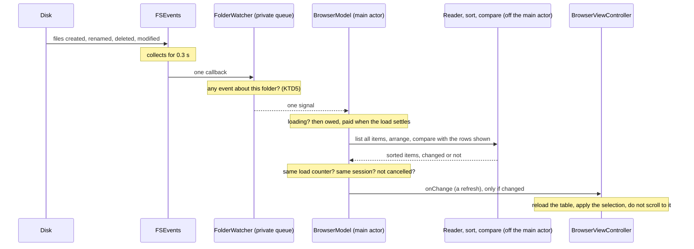

# Phase 1A Step 4 Live Updates - Plan

## Goal Capsule

- **Objective:** Someone looking at a folder in Cairn sees what is in it now. A file that another app creates, renames, deletes or changes shows in the list within a second, without their doing anything, and their selection, scroll position and keyboard focus stay where they were (quality bar 5).
- **Means:** One FSEvents stream per folder that is on screen (KTD1 to KTD7), and a whole-folder refresh that runs off the main actor and joins the step 3 pipeline through the load counter (KTD8 to KTD12).
- **Authority:** R1 to R29 come from the step's brief and from `plans/phase-1a-browse.md` (the step 4 row). Where a KTD and an R disagree, the R wins. Requirements marked "default" are unconfirmed bets listed under Assumptions; the user may change one without reopening the rest.
- **Execution profile:** One new source file and one changed check script in `FileSystemCore`, changes to three source files in `BrowserUI`, three new unit-test files, two end-to-end tests touched, and five documents. No FSEvents behavior was probed while planning, so U1 starts with the tests that ask FSEvents the questions listed under Open Questions. Three proofs need the user at the development Mac: `make uitest` (it asks for an authentication prompt), `make perf` (that Mac is the reference Mac) and the VoiceOver check.
- **Stop and tell the user when:**
  - a test that uses a real FSEvents stream fails some of the time, locally or on a runner: do not loosen or drop it;
  - the one-second test (U5) fails on the development Mac;
  - the VoiceOver check fails expectation 1, 2, 3 or 4 under U5;
  - `make perf` on the reference Mac reports the first-rows target missed, or a first-rows time well above the 0.026 s baseline;
  - UI automation is needed and the authentication prompt has not been approved;
  - a unit test fails on macOS 15 or macOS 26 only;
  - the pull-request CI run or the manual macOS 15 run is red and the cause is not understood, or a fix would need a change under `.github/workflows/`.
- **Who finishes:** The implementer lands U1 to U6 on branch `phase-1a/live-updates`, runs the review and lessons steps, makes the one commit, opens the pull request, starts the macOS 15 run by hand and merges when both are green.

---

## Product Contract

### Summary

Phase 1A step 4 keeps the list of a folder that is on screen in step with the disk. The showing tab of each window watches its folder through FSEvents. Changes are collected for 0.3 s and answered by one refresh, which lists and sorts the folder off the main actor and replaces the rows only when something visible changed. A refresh never shows the loading state or unsorted rows. A folder that is deleted or renamed away shows why it cannot be listed, as a failed listing does today.

### Problem Frame

A browser lists its folder once, when it is opened. A file that another app adds, renames, deletes or changes shows only after the user navigates away and back, and the app has no reload command.

Calling `BrowserModel.load()` on every change would not do, for three reasons found in the current source:

- `load()` sets `state` to `.loading` before it lists. `BrowserViewController.modelDidChange()` hides the status text while loading, so "This folder is empty." would blink on every change.
- `modelDidChange()` ends with `applyModelSelection()`, which scrolls the first selected row into view. Every change on disk would pull the list back to the selection.
- A load goes through `BrowserViewController.run`, which cancels the load in flight. A change on disk would cancel a navigation.

Step 3 made a load publish twice and taught three rules for it (`docs/solutions/2026-10-10-a-load-that-publishes-twice.md`): check after every wait, check again after the stream ends, and retire the old load at the move. That note names step 4 as the third way for rows to arrive, with its own question to answer: what happens to a change that arrives for a folder the user just left.

### Requirements

**Changes appear**

- R1. While a browser is on screen, an item created, renamed, deleted or modified directly inside its folder, by any process, shows in the list without any action by the user.
- R2. The change shows within 1 s (quality bar 5). The bound is asserted by one test on a small folder, on every Mac that runs the tests (default for the folder size).
- R3. A change to what a direct subfolder holds reaches the list too, because it changes the subfolder's modified date (default).
- R4. Changes are collected for 0.3 s and answered by one refresh. Changes that arrive while a refresh is running are answered by exactly one more.
- R5. A refresh that finds the visible rows unchanged publishes nothing: no table reload, nothing for VoiceOver to notice (default).

**Fits the step 3 pipeline**

- R6. A refresh never shows the loading state, first rows or unsorted rows. The rows on screen stay until the sorted result replaces them.
- R7. A change that arrives while a load is in flight, the time its first rows are showing included, is answered by one refresh after the load settles. It is neither dropped nor answered early.
- R8. A refresh that was superseded by a move or a load, or whose watch has stopped, publishes nothing, whichever stage it had reached.
- R9. A refresh lists, filters, sorts and compares the whole folder off the main thread. A refresh of a 10,000-item folder leaves the main actor free; the main actor only takes the result and reloads the table.
- R10. A refresh never cancels or delays a load, and a load is never slower to its first rows because the folder is watched.

**Selection, scroll, focus and VoiceOver**

- R11. The selection stays on the items that still exist, matched by name, and items that are gone drop out of it. A selection the user makes while a refresh is under way is the one kept.
- R12. The list keeps its scroll offset through a refresh. A refresh does not scroll the list to the selection.
- R13. Keyboard focus does not move because of a refresh.
- R14. VoiceOver keeps its place and hears nothing it did not ask for: the app posts no announcement for a refresh, and the selected item is not read again because other rows changed. Judged by hand (U5).

**The watched folder itself goes away**

- R15. When the folder being shown is deleted, renamed away or replaced by a file, the rows are cleared and the reason is shown, as for a failed listing today. The app does not crash, the browser never enters the loading state for it, and Back, Forward and Enclosing Folder still work.
- R16. When a folder exists again at that path, the browser lists it by itself (default).

**When a folder is watched**

- R17. A folder is watched only while its browser is on screen: the showing tab of a pane whose view is on screen. A tab that is not showing, and a tab that has never been shown, watch nothing.
- R18. Watching stops when the browser leaves the folder, when its tab is hidden or closed, when its window closes, and when the browser's model goes away. A move starts the watch of the new folder as the command arrives.
- R19. A browser that comes back on screen brings its list up to date by itself, because nothing was watching while it was away.
- R20. A watch that cannot start, or ends early, leaves the browser working without live updates. It is logged, and nothing is shown to the user.

**Standing rules and proof**

- R21. The watcher lives in `FileSystemCore` and imports no UI framework. Every function of it that touches the file system starts with `MainThreadGuard.assertOffMainThread()`, and a test proves each guard fires.
- R22. A folder reached through a symbolic link, as every location under `/var` and `/tmp` is, is watched correctly.
- R23. The watcher logs through `Log.fileSystem`. Paths and file names stay private.
- R24. The code compiles under Swift 6 strict concurrency with warnings as errors, and runs on macOS 15.
- R25. Unit tests of the model, the controller and the pane use stubs and hooks and never wait on a clock. Tests that need a real FSEvents stream wait with a bound and touch only fixture folders. One test asserts the 1 s bound of R2.
- R26. Every existing unit test and end-to-end test passes unchanged.
- R27. The step adds no control. Any control added after all goes through `AccessibilityElement` and `apply(_:)`.
- R28. `make perf` still reports the 200 ms first-rows target met on the reference Mac. `docs/performance/baseline.json` is not re-recorded.
- R29. `ARCHITECTURE.md`, `README.md` and the status line in `CLAUDE.md` describe the app as it is after this step. The step's curriculum page, `docs/curriculum/phase-1-step-04-live-updates.md`, and its row in `docs/curriculum/README.md` are in the step's commit. The step lands as one commit named `Phase 1 step 4: live updates` on `phase-1a/live-updates`, through a pull request merged only when CI and a macOS 15 run started by hand are green.

### Success Criteria

- With the app showing a folder, `touch`, `mv` and `rm` in Terminal show in the list before the user has looked back at the window.
- With a 100,000-item folder open and a file added to it from Terminal, the window answers a click while the refresh is under way.

### Scope Boundaries

Out of scope for this step:

- Network and cloud locations. FSEvents does not report a change that another computer makes on a network share. Those locations get their own treatment later in Phase 1, as step 3 already said for slow volumes.
- A reload command (Command-R). Nothing in the step needs one once changes arrive by themselves.
- Watching the expanded folders of an outline. That is step 5's; the watcher takes one folder per stream so step 5 can ask once per expanded folder.
- Following a folder that was renamed to its new place, as Finder does. It needs the folder tracked by file identity, and the history holds paths. Phase 1's link and identity handling should decide the rule (`docs/solutions/2026-10-09-listing-a-symlinked-location.md`).

Considered and not built:

- Updating only the item that changed, from file-level events. A refresh of 10,000 items costs about 75 ms off the main thread (the step 3 measurements), which is inside the bound. A 100,000-item folder that has to meet 1 s would change the call (see Assumptions).
- Inserting and removing single table rows instead of reloading the table. Step 3's probe showed a full reload keeps the scroll offset and focus and takes 3 to 5 ms at any size, and step 5 replaces the table with an outline view. A failed VoiceOver expectation under U5 would change the call, and is a stop condition.
- Holding the first visible item in place when rows are added above it. The offset is kept, so the rows in view shift by the height of what was added. A report that the list jumps while being read would change the call.
- Keeping the selection on an item that was renamed elsewhere. A rename looks like a deletion and a creation to a listing, and a selection is matched by name.
- Listing only after the watch is live, so that a navigation's own listing would close the gap of KTD12. It would put the watcher's start in front of every first row, which R10 forbids. A profile showing the extra listing matters would change the call.
- A debounce timer of the app's own. FSEvents already collects events for a stated time, and a second clock would need a second way to test it.
- Showing the first change at once and collecting only what follows it (`kFSEventStreamCreateFlagNoDefer`). A burst would then cause two refreshes, the first of a half-finished state.
- Watching tabs that are not showing. R19 brings them up to date when they are shown.
- A spoken announcement when rows change or when the folder goes away. Nothing is announced for a failed listing today, and R14 asks for less speech.
- Telling the user that a watch could not start. The list still works; the log has the reason.
- Leaving a folder that went away for its nearest existing parent. The browser stays put and says why, so the user decides where to go.
- Guarding a double-click whose two clicks straddle a refresh. Same reasoning as step 3: the rows move rarely and the risk is recorded.
- A performance measurement or target for a refresh. The bound of R2 is asserted by a test, and R9 by a test that needs no clock.

---

## Planning Contract

### Key Technical Decisions

**The watcher (`FileSystemCore`)**

- KTD1. **One FSEvents stream per watched folder, behind a protocol that hands over an async stream of "look again" signals.** `FolderWatching` mirrors `DirectoryReading`: a nonisolated function takes a folder and returns a stream, the work runs off the caller's actor, and ending the stream from the consumer's side stops the FSEvents stream. `FolderWatcher` is the real one. A signal is one of three cases, kept apart for logs and tests: the watch is live, the folder's contents changed, the folder itself changed. A consumer treats all three the same. The stream keeps only the newest signal while its consumer is busy. Alternatives rejected:
  - A `DispatchSource` on the folder's file descriptor. It fires when entries are added or removed but not when a file inside is modified, and the milestone names FSEvents.
  - One shared stream for every watched folder. Each window watches one folder today, and one stream per folder makes "stop watching" the end of one object.
- KTD2. **Directory-level events, and a refresh that lists the folder again.** The stream is created without `kFSEventStreamCreateFlagFileEvents`, so an event names the folder in which something changed, not the item. The refresh goes through the existing reader, so every rule about symbolic links, hidden items and vanished items is the reader's, in one place.
- KTD3. **Stream flags: `WatchRoot` and `UseCFTypes`; events since now; delivery on a private serial dispatch queue.** `WatchRoot` reports a rename or deletion of the folder or of any folder above it. `IgnoreSelf` is not set: Phase 1's own file operations must show in the list like anyone else's. Scheduling on a run loop is deprecated since macOS 13.
- KTD4. **The coalescing interval is 0.3 s, and it is FSEvents' own latency.** Without `NoDefer`, the first event after a quiet spell starts the timer and everything in the next 0.3 s arrives as one callback (`FSEvents.h`). One callback that passes KTD5 becomes one signal. A single change therefore shows after 0.3 s plus one refresh: about 0.31 s for a small folder and about 0.4 s at 10,000 items, against the 1 s bound. The number is a named constant.
- KTD5. **A pure function decides whether an event concerns the folder.** It does when the event's path is the folder, when it is a direct subfolder (R3), or when its flags say the folder itself changed or events were dropped (`RootChanged`, `MustScanSubDirs`). Paths are compared without their trailing slash. Anything deeper is ignored, because FSEvents always watches a whole tree. Being pure, the rule is tested without a stream.
- KTD6. **The folder is resolved with `realpath` before the stream is created, and events are compared with the resolved path.** FSEvents reports real paths, so a location under `/var` would otherwise match none of its own events. A location that cannot be resolved, such as a folder that does not exist yet, is watched as spelled. A root-changed event is recognized by its flag, never by its path.
- KTD7. **Starting a stream is a synchronous, guarded function run in a task that leaves the caller's actor.** It follows `DirectoryReader.listing(in:)` and `readItems`. The "live" signal is sent after `FSEventStreamStart` has returned true. Stopping, invalidating and releasing happen on the stream's own queue, so no callback runs afterwards. A stream that cannot be created or started logs an error and ends its async stream without a signal (R20).

**The model (`BrowserUI`)**

- KTD8. **The model owns one watch session, and the session is the only place a refresh runs.** The owner turns watching on and off. A session is one task that reads the signals of one folder and answers each with a refresh pass, one at a time. A move ends the session and starts the next one as the command arrives, inside `prepareToShow`, where step 3 already retires the load in flight. A load never refreshes and a refresh never loads, so `load()` and everything that awaits it behave as today.
- KTD9. **A refresh pass is the whole listing, the existing filter and sort, and a comparison, all off the main actor.** It reads `reader.items(in:)`, which waits for the all-items event and ignores first items, so unsorted rows cannot appear (R6). It never sets `state` to `.loading`. A new nonisolated function compares the arranged items with the rows on screen, so a 100,000-item comparison does not run on the main actor either (R9). The pass publishes only when the two differ, or when the browser was showing a failure and the listing now succeeds.
- KTD10. **A refresh reads the load counter and never changes it.** It captures `generation` when it starts and checks it, the task's cancellation and its session after every wait. A move or a load bumps the counter, so either one retires a refresh in flight, and a refresh can never retire a load (R8, R10). This is the "am I still wanted" rule of step 3 applied to a third arrival.
- KTD11. **A signal that arrives during a load is owed, and is paid when the load settles.** The session sets it aside while `state` is `.loading`. A load that settles or fails with a signal owed sends the session one signal. A load that starts clears what is owed, because its listing begins after every signal so far. The first rows of step 3 are therefore never replaced by a refresh (R7).
- KTD12. **Every start of a watch is followed by a look.** The "live" signal is a signal like any other. It closes the gap between a listing and the moment its watch became live, and it is what brings a tab up to date when it is shown again (R19). The cost is one extra listing after each navigation in a browser that is on screen; it runs off the main actor after the load has settled and publishes nothing when nothing changed.
- KTD13. **The model says what kind of publish it made, and the controller does not scroll to the selection for a refresh.** The selection is recomputed with the existing `BrowserModel.matching`, from the selection as it is when the pass publishes (R11). The controller still reloads the whole table and applies the model's selection under the existing flag, as step 3's KTD9 established; only the scroll into view is skipped (R12).
- KTD14. **A folder that went away is a refresh whose listing fails.** There is no separate "gone" path: a root-changed signal means "look again", the listing throws, and the model clears the rows and sets `.failed` with the error's text, publishing once. The same failure seen again publishes nothing. The session stays, so a signal after the folder is back lists it (R16).

**The owner (`BrowserUI`)**

- KTD15. **The pane decides which browser watches.** Only the pane knows which tab is showing, as with the window's title and keyboard focus. The showing browser watches while the pane's view is on screen, which the pane learns from `viewDidAppear` and `viewDidDisappear`; every other browser does not. One function brings the browsers in line and is called wherever the tab list or the pane's place on screen changes.
- KTD16. **An initializer that is given a reader watches nothing unless it is also given a watcher.** The app passes neither and gets the real reader and the real watcher. Every existing test passes a stub reader or never puts its browser in a pane, so none starts a real stream and none needs a change (R26). A test can never forget its way into watching a path outside its fixture.

**Proof**

- KTD17. **Three layers of tests.** The model, controller and pane are tested with a stub watcher, the stub reader's gates and one new hook that fires when the session has finished with a signal; no test waits on a clock. The real watcher is tested against FSEvents on fixture folders with bounded waits that assert an event arrives, never how many, because a new stream can deliver events from just before it started. One test puts the real watcher, the real reader and a model together and asserts the 1 s bound. The end-to-end tests prove the wiring in the running app with their usual 10 s waits.
- KTD18. **`scripts/check-main-thread-guard.sh` learns `FSEventStreamCreate` and `realpath`.** The watcher's file calls both, and the check's list is what makes "enforced" true in `ARCHITECTURE.md`. `DirectoryReader.swift` already calls `realpath` and already has its guard.

### High-Level Technical Design

A change made by another process, in a folder that is on screen and loaded:



What the session does with a signal, by the model's state:

| State when the signal arrives | What happens | What is published |
| --- | --- | --- |
| `.loaded` | A refresh pass | The new rows and the selection by name, if the visible rows changed; otherwise nothing |
| `.loaded`, a pass already running | The signal waits; one more pass follows | As above |
| `.loading`, before or after first rows | Set aside as owed; one signal is sent when the load settles or fails | Nothing from the signal itself |
| After a move, before its load has started | A refresh pass of the new folder starts; the load retires it when it starts (KTD10) | Whatever the pass finished first; the load then publishes as today |
| `.failed` | A refresh pass | The rows and `.loaded` if the folder can be listed now; nothing if it fails the same way |
| Any, and the listing now fails | The pass ends in failure | Empty rows, empty selection, `.failed` with the reason, once |
| Any, then a move, a load or the end of the watch during the pass | The pass stops at its next check | Nothing |

When a folder is watched:

| Event | Watch of the old folder | Watch of the new or same folder |
| --- | --- | --- |
| The pane's view appears | | Starts for the showing tab |
| A move in the showing tab | Stops as the command arrives | Starts as the command arrives |
| Another tab is shown, or a new tab opens | Stops for the tab that was showing | Starts for the tab now showing |
| A tab is closed | Stops, with its load | Starts for the tab now showing, if that changed |
| The pane's view disappears (the window closes) | Stops | |
| The model goes away without being told | Stops | |

A session, in outline. Directional, not an implementation:

```text
start watching (owner) or move while watching:
  end the session in hand; nothing is owed
  ask the watcher for the folder's signals now; start a session task on them

session task, for each signal (newest kept while busy):
  stop unless this is still the session
  state is loading -> owed = true; continue
  refresh pass:
    remember the load counter and the rows shown
    all = try await reader.items(in: folder)          stop unless still wanted
    sorted = try await arrange(all, sort, hidden)      stop unless still wanted
    changed = await differs(sorted, rows shown)        stop unless still wanted
    failed before, or changed -> items = sorted; selection = matching(selection); state = loaded; publish as a refresh
    listing threw, not a cancellation -> if not already failed this way: clear rows and selection; state = failed; publish
  tell the hook the signal is finished

load(): on starting, owed = false; on settling or failing while still wanted, if owed: owed = false, send the session one signal
```

### Assumptions

These are unconfirmed bets. Each names what changes if the user decides otherwise.

- The 1 s bound is judged on a small folder (R2). Arithmetic from the step 3 measurements puts a 10,000-item folder at about 0.4 s and a 100,000-item folder at about 1.2 s, over the bound. Meeting it at 100,000 items means updating single items from file-level events, which is listed under "Considered and not built".
- Changes are collected for 0.3 s, and the first change waits with the rest (KTD4). A shorter interval means more refreshes during a long burst; showing the first change at once means two refreshes for a short burst.
- A change inside a direct subfolder refreshes the parent (R3). Without it a subfolder's modified date goes stale. With it, a busy subfolder causes a refresh of the parent every 0.3 s, which publishes only when a visible row changed.
- A refresh that changes nothing visible publishes nothing (R5).
- A folder that goes away leaves the browser where it is, showing the reason (R15), and a folder that comes back is listed (R16). The alternative is to move to the nearest folder that still exists.
- A browser is "on screen" when AppKit says its pane's view has appeared and not yet disappeared (KTD15). Whether a minimized or hidden window counts follows from what AppKit reports; either answer is correct because of R19.
- Each navigation in a watched browser costs one extra listing in the background (KTD12).
- The scroll offset is kept, not the first visible item (R12), and the selection follows names, not file identity (R11).
- The table is reloaded whole (KTD13).
- The app adds no spoken announcement, and VoiceOver behavior is judged by hand (R14).
- No performance measurement is added and the baseline is not re-recorded (R28).
- One new end-to-end launch is added, and one existing launch is extended (U5).

### Open Questions

None blocks the work. Each is an FSEvents or AppKit behavior that planning read about and did not run; the named test settles it, and the fallback is already chosen.

- Does a stream keep reporting after its folder is deleted and created again at the same path? U1's test decides. If it does not, the watcher ends the stream on a root-changed event and starts a new one on the same location.
- Is a change made straight after the "live" signal always delivered? U1's first test decides. If it is not, the stop condition for unstable FSEvents tests applies.
- Does AppKit send `viewDidDisappear` to the pane when its window closes, on macOS 15, 26 and 27? U4's real-window test decides. If it does not, the pane also listens for its window's will-close notification.
- What does VoiceOver say when the item under its cursor is deleted elsewhere, and when the folder itself goes away? U5 records both as observations.

### Risks

| Risk | Mitigation |
| --- | --- |
| Reloading the table and selecting the same rows again may make VoiceOver read the selected row on every refresh. | R5 removes refreshes that change nothing. The U5 check judges the rest; failing it is a stop condition, and the fallback is single-row inserts and removals. |
| FSEvents behaves differently on macOS 15, 26 and 27, or in a runner's virtual machine. | The real-stream tests run on macOS 26 in CI and on macOS 15 by hand before the merge. They assert that an event arrives within a bound, not how many or how fast, apart from the one-second test. |
| The one-second test asserts on a clock and may fail on a loaded runner. | A small folder leaves about 0.7 s of margin. An unstable result is a stop condition, not a reason to widen the bound. |
| A refresh between the two clicks of a double-click opens the item that moved under the pointer. | Not guarded, as in step 3; recorded under "Considered and not built". |
| A table reload lands while the user is dragging a selection. | Covered by the manual check in U5; R5 keeps reloads to real changes. |
| A stream outlives its browser and keeps a folder watched. | R18's tests end a watch five ways and wait for the watcher's own "stopped" hook each time. |
| A nonisolated async function stops leaving the caller's actor if a package enables `NonisolatedNonsendingByDefault`. | U2's thread-recording test fails if the comparison runs on the main thread, as step 3's does for the sort. |
| The development Mac runs short of disk space during package builds (`docs/solutions/2026-10-09-running-package-tests.md`). | Check free space before `make test`. |

---

## Implementation Units

### U1. A watcher for one folder

- **Goal:** `FileSystemCore` can watch a folder and hand "look again" signals to any actor, and stops cleanly when its consumer stops.
- **Requirements:** R1, R3, R4, R18, R20 to R25
- **Dependencies:** none
- **Files:**
  - `Packages/FileSystemCore/Sources/FileSystemCore/FolderWatcher.swift` (new)
  - `Packages/FileSystemCore/Tests/FileSystemCoreTests/FolderWatcherTests.swift` (new)
  - `Packages/FileSystemCore/Tests/FileSystemCoreTests/MainThreadGuardTests.swift`
  - `scripts/check-main-thread-guard.sh`
  - `scripts/test-source-checks.sh`
- **Approach:**
  1. The protocol, the signal type and the real watcher follow KTD1 to KTD7. The file imports `CoreServices` beside `Foundation` and `os`.
  2. The relevance rule (KTD5) is a static function of an event's path, its flags and the resolved folder.
  3. The synchronous start function is the guarded entry point. It takes internal hooks for tests: one called when the stream has been stopped and released.
  4. The C callback reaches its state through the stream's context pointer. The state is confined to the stream's queue; the type that holds the stream reference is marked unchecked-sendable with a comment naming that queue.
  5. Add `FSEventStreamCreate` and `realpath` to the check's pattern, with a must-fail case for each in `scripts/test-source-checks.sh`, built under a path with a space as the existing cases are.
- **Execution note:** Write the real-stream tests first and run them before the model work starts. They answer the first two Open Questions, and their answers shape the watcher.
- **Patterns to follow:** `DirectoryReader.listing(in:onCancellationCheck:)` for a task that leaves the caller's actor and a stream whose termination cancels the work; `readItems` for a guarded synchronous worker with a test hook; `followingSymbolicLinks` for `realpath`; `listsAFolderReachedThroughASymbolicLink` for building a link in a fixture.
- **Test scenarios:**
  - Pure, the relevance rule: the folder itself, with and without a trailing slash, concerns it. A direct subfolder does. A folder two levels down does not. A sibling whose name starts with the folder's name (`/a/b2` for `/a/b`) does not. Any path with the root-changed flag does. Any path with the must-scan flag does.
  - Real stream: after the "live" signal, creating a file in the folder brings a signal within the bound.
  - Real stream, one test: renaming a file, deleting it, and appending bytes to another each bring a signal.
  - Real stream: creating a file inside a direct subfolder brings a signal.
  - Real stream: a folder watched through a symbolic link to it reports a file created in it.
  - Real stream: deleting the watched folder brings a signal, and so does renaming it away.
  - Real stream: after the folder is deleted and created again, a file created in it brings a signal.
  - Real stream: 200 files created in one loop bring far fewer than 200 signals, counted over a fixed second after the loop. This is the one test that waits a fixed time, because the collecting is FSEvents' own.
  - Cancelling the consuming task calls the "stopped" hook, and a file created afterwards calls nothing.
  - A location that does not exist can be watched without an error, and the stream reaches "live".
  - Calling the start function on the main actor inside `MainThreadGuard.withHandler` records one violation naming it. Consuming the signals on the main actor records none.
  - `scripts/test-source-checks.sh`: a file that calls `FSEventStreamCreate` without a guard is rejected, one that calls `realpath` without a guard is rejected, and each passes with a guard.
- **Verification:** The real-stream tests pass ten runs in a row on the development Mac. The relevance scenarios are seen to fail against a rule that compares paths by prefix.

### U2. Two listings compared off the main actor

- **Goal:** A refresh can learn whether the sorted result differs from the rows on screen without holding the caller's actor.
- **Requirements:** R5, R9
- **Dependencies:** none
- **Files:**
  - `Packages/FileSystemCore/Sources/FileSystemCore/FileItemSort.swift`
  - `Packages/FileSystemCore/Tests/FileSystemCoreTests/FileItemSortTests.swift`
- **Approach:** One nonisolated async function beside `arranged(_:includingHidden:)`, with the same internal start hook for the thread test. Two listings are the same when they hold equal items in the same order.
- **Patterns to follow:** `arranged(_:includingHidden:onCancellationCheck:)` and its thread-recording test.
- **Test scenarios:**
  - Equal arrays are the same. A different order, one item more, one item fewer, and one item whose size or modified date changed are each different.
  - Two empty listings are the same.
  - Awaited from a main-actor task, the start hook reports a thread that is not the main thread.
- **Verification:** The thread scenario is seen to fail when the function is marked for the main actor.

### U3. The model watches its folder and refreshes

- **Goal:** `BrowserModel` answers signals with refreshes that obey the table under High-Level Technical Design, under every way a refresh can end.
- **Requirements:** R4 to R11, R15, R16, R18 to R20, R25, R26
- **Dependencies:** U1, U2
- **Files:**
  - `Packages/BrowserUI/Sources/BrowserUI/BrowserModel.swift`
  - `Packages/BrowserUI/Tests/BrowserUITests/StubWatcher.swift` (new)
  - `Packages/BrowserUI/Tests/BrowserUITests/StubReader.swift`
  - `Packages/BrowserUI/Tests/BrowserUITests/BrowserModelWatchTests.swift` (new)
- **Approach:**
  1. Apply KTD8 to KTD14 and KTD16. The model gains the watcher, the two calls that turn watching on and off, the kind of its last publish, and the internal hook of KTD17.
  2. The signals of a new folder are asked for synchronously, in the call that turns watching on and in `prepareToShow`, so a test can see the request as the command arrives.
  3. `load()` changes in two places only: it clears what is owed when it starts, and pays it after its final publish. Its signpost intervals end before that, so `LoadFolder` and `FirstRows` measure what they do today.
  4. `StubWatcher` hands the test the continuation of each folder's stream, records which folders were asked for, and lets a test await the end of a folder's stream. `StubReader` gains a record of the folders it was asked to list, so a test can count listings.
- **Execution note:** Write each scenario first and see it fail against a model without the behavior. The existing `BrowserModelTests` are the characterization and stay green throughout.
- **Patterns to follow:** `reloadingKeepsTheRowsUntilTheSortedResultReplacesThem` for holding a second listing at a gate that was closed again; `whileTheSortIsHeldTheMainActorIsFreeAndANewerLoadWins` and `arrangeHeldOnce(at:)` for holding the sort; `aMoveRetiresTheLoadInFlightBeforeTheNextLoadStarts` for a move with no load after it.
- **Test scenarios:**
  - A model that was never told to watch asks the watcher for nothing. Told twice, it asks once.
  - Loaded, then a signal with a changed listing: `items` are the new sorted rows, the publish says it was a refresh, there is exactly one publish, and `state` was `.loaded` at every publish.
  - A signal with the same listing publishes nothing.
  - A signal after only a hidden item changed, with hidden files not shown, publishes nothing.
  - A signal for a folder larger than one batch, held between the reader's two events: `items` are still the old sorted rows and nothing was published. After the gate, the new sorted rows.
  - With `a` and `b` selected, a refresh that removes `b` and adds `c` leaves `a` selected.
  - A selection made while the refresh is held at the reader is the selection after it.
  - A signal while a load is held before its listing arrives: the reader is not asked again until the load has settled, then exactly once more.
  - A signal while a load's first rows are showing: the first rows stay, the load settles sorted, then one refresh runs.
  - A load that starts after a signal was set aside, with no signal during it, is followed by no refresh.
  - Back to a folder with a remembered selection, with a signal sent between the move and the start of its load, the refresh held at the reader: the load's sorted rows stand, the remembered selection is restored, and the held refresh publishes nothing when released.
  - Three signals while a refresh is held: exactly one more listing follows it.
  - A move while a refresh is held at the reader, and separately while it is held at the sort: nothing from the old folder is published, the old folder's stream has ended, and the new folder's signals were asked for before the move returned.
  - `load()` on the same folder while a refresh is held: the refresh publishes nothing and the load's result stands.
  - Watching turned off while a refresh is held: nothing is published, the stream has ended, and a later signal starts nothing.
  - While the sort of a refresh is held, the test, which runs on the main actor, reads the model and sends it a move.
  - The listing fails on a signal: `items` and `selection` are empty, `state` is `.failed` with the error's text, there is one publish, and `state` was never `.loading`. A second signal with the same failure publishes nothing. Going back from there loads the previous folder.
  - Failed that way, then the folder lists again on a signal: the rows are shown and `state` is `.loaded`.
  - A folder that failed its first load is listed after a signal once it can be.
  - The "live" signal alone causes one listing after the load has settled.
  - A watcher whose stream ends at once: the model loads and moves as before.
  - The last reference to a watching model is dropped: the folder's stream ends.
  - Every existing test in `BrowserModelTests` passes unchanged.
- **Verification:** No scenario waits on time; each waits on a gate, the hook, or the stub's end-of-stream. Each has been seen to fail once.

### U4. The list through a refresh, and the pane that decides who watches

- **Goal:** In a real table a refresh keeps the selection, the scroll offset and keyboard focus, and the pane watches exactly the browser that is on screen.
- **Requirements:** R11 to R13, R15, R17 to R19, R26, R27
- **Dependencies:** U3
- **Files:**
  - `Packages/BrowserUI/Sources/BrowserUI/BrowserViewController.swift`
  - `Packages/BrowserUI/Sources/BrowserUI/PaneViewController.swift`
  - `Packages/BrowserUI/Tests/BrowserUITests/BrowserViewControllerTests.swift`
  - `Packages/BrowserUI/Tests/BrowserUITests/PaneViewControllerTests.swift`
- **Approach:**
  1. `BrowserViewController` takes the watcher in the initializer that takes a reader (KTD16), passes on the owner's "watch" and "stop watching", and skips the scroll into view for a refresh (KTD13). Nothing else in `modelDidChange()` changes.
  2. `PaneViewController` takes the watcher beside its reader and applies KTD15: its one function is called from `showTabs()`, from `close(_:)` beside `cancelLoad()`, from `viewDidAppear` and from a new `viewDidDisappear`.
  3. The new tests call `viewDidAppear()` and `viewDidDisappear()` by hand, as `aBrowserLeavesTheWindowsTitleAndKeyboardFocusAlone` does, apart from the one that asks AppKit.
- **Patterns to follow:** `browserShowingFirstRows(of:heldAt:)`, `theListKeepsItsScrollOffsetWhenItSettlesWithNothingSelected` and `keyboardFocusStaysWhereItIsThroughBothArrivals` in `BrowserViewControllerTests`; `paneInAWindow` and `closingTheMiddleTabShowsItsRightNeighbourAndCancelsItsListing` in `PaneViewControllerTests`.
- **Test scenarios:**
  - A refresh adds a row that sorts above the selected one: the same item is selected at its new row, the model's selection is unchanged, and the table's selection was not written back as a user's.
  - The list is scrolled so the selected row is out of view, in a window; a refresh changes another row: the clip view's origin is unchanged. The same with nothing selected.
  - With the table as first responder, and separately with another view: the first responder is the same object after a refresh.
  - A refresh that changes nothing does not reload the table.
  - An empty folder gains an item on a refresh: the status text is hidden at that publish. A folder emptied by a refresh shows "This folder is empty." at that publish. The status text was never hidden in between for a folder that stayed empty.
  - The folder fails on a refresh: the table has no rows and the status text shows the reason.
  - Open sent for a folder while a refresh is held: the browser moves there and ends loaded. Back sent twice with no await while a refresh is held ends on the right folder, loaded.
  - A pane whose view has not appeared watches nothing. After `viewDidAppear`, the showing browser's folder is watched and no other.
  - New Tab: the new tab's folder is watched and the first tab's stream has ended.
  - Showing the first tab again: its folder is watched, the other stream has ended, and one refresh of the first tab runs.
  - Closing the showing tab ends its stream and starts the watch of the tab now showing. Closing a tab that is not showing changes no watch.
  - `viewDidDisappear` ends the showing browser's stream. `viewDidAppear` after it starts the watch again and one refresh runs.
  - In a window ordered front and then closed, the showing browser's stream ends without the test calling `viewDidDisappear`.
  - A pane built with a stub reader and no watcher starts no stream after `viewDidAppear`.
  - Every existing test in `BrowserViewControllerTests`, `PaneViewControllerTests`, `BrowserToolbarTests` and `AccessibilityTests` passes unchanged.
- **Verification:** These tests pass on macOS 27 locally, on macOS 26 in CI and on macOS 15 in the manual run. The scroll scenario is seen to fail with the scroll into view left in.

### U5. The real pieces together, the running app, and the checks by hand

- **Goal:** The 1 s bound is asserted once with a real FSEvents stream, the running app shows changes made by another process, and a person has checked what a test cannot.
- **Requirements:** R1, R2, R14 to R16, R19, R22, R25, R28
- **Dependencies:** U4
- **Files:**
  - `Packages/BrowserUI/Tests/BrowserUITests/LiveUpdateTests.swift` (new)
  - `UITests/BrowsingTests.swift`
  - `UITests/TabsTests.swift`
- **Approach:**
  1. `LiveUpdateTests` builds a `BrowserModel` with the real `DirectoryReader` and the real `FolderWatcher` on a fixture folder, turns watching on, loads, and waits for the hook to report the "live" signal finished before it touches the disk.
  2. The end-to-end tests change the fixture from the test runner, which is another process to the app and shares its temporary folder (`docs/solutions/2026-10-09-walking-skeleton-notes.md`).
  3. One new test in `BrowsingTests` is one new launch. It ends with the folder gone, so it cannot share a launch with a test that goes on browsing. The tab case joins the existing launch of `testTabsKeepTheirOwnFolderHistoryAndSelection`.
- **Patterns to follow:** `HistoryTests.row(_:in:)` for a row's selected state; `waitForRowCount` in `BrowsingTests`; `testAMissingFolderShowsWhyItCouldNotBeListed` for the status text.
- **Test scenarios:**
  - `LiveUpdateTests`, the bound: a folder of 100 files, loaded and watched. A file is created and a clock started; the model publishes a list that holds the new name in under 1 s. A failure to publish at all ends the test after 10 s.
  - `LiveUpdateTests`: a model whose location is spelled through a symbolic link to the fixture folder shows a file created in it, with a selection made before the change still on the same name.
  - `LiveUpdateTests`: the watched folder is removed: the model reaches `.failed` and was never `.loading` on the way. The folder is created again with one file: the model reaches `.loaded` with that file.
  - `BrowsingTests`, new test, one launch: launched on the fixture, `beta.txt` is clicked. The runner creates `gamma.txt`: a fourth row appears and `beta.txt` is still selected. The runner renames `alpha.txt`: the new name is there and the old one is not. The runner deletes `gamma.txt`: three rows. The runner appends bytes to `beta.txt`: its size text changes. `Sub` is opened and the runner removes it: the status text appears with a reason and the table has no rows. Command-[ returns to the fixture, which lists two rows.
  - `TabsTests`, added to the existing launch: with two tabs open, the runner creates a file in the folder of the tab that is not showing; that tab is shown and the file is in its list.
  - By hand, with VoiceOver on, in a folder of about 20 items:
    1. With the VoiceOver cursor on a row, a file created from Terminal appears and VoiceOver says nothing by itself and stays on the same item.
    2. With a row selected, another file is renamed and then deleted from Terminal: the selected row stays selected and is not read again.
    3. A loop appends to a file twice a second for ten seconds: VoiceOver says nothing by itself.
    4. Keyboard focus is in the list before and after each of the above.
    5. Observation: what VoiceOver says when the item under its cursor is deleted from Terminal.
    6. Observation: what VoiceOver says when the folder being shown is deleted, and whether the status text is reached with the usual keys.
    7. The check step 3 postponed: opening a 10,000-item folder, the list is not read out twice as it settles.
  - By hand, without VoiceOver: a file added from Terminal to a 10,000-item folder and to a 100,000-item folder appears, the window answers a click meanwhile, and a selection being dragged while files are added is not lost.
- **Verification:** The end-to-end suite grows by one launch. The by-hand results, the two observations included, go into the lessons note. Expectations 1 to 4 are pass or fail.

### U6. Documents and the curriculum page match the finished step

- **Goal:** The documents describe the app after U1 to U5, and the step has its teaching page.
- **Requirements:** R29
- **Dependencies:** U1 to U5, and the review step's fixes
- **Files:**
  - `ARCHITECTURE.md`
  - `README.md`
  - `CLAUDE.md`
  - `docs/curriculum/phase-1-step-04-live-updates.md` (new)
  - `docs/curriculum/README.md`
- **Approach:**
  1. `ARCHITECTURE.md`: add `FolderWatcher` to the `FileSystemCore` row and `CoreServices` to what it may import; add a section on how a change on disk reaches the list, after "How a folder gets on screen"; say in "Tabs" that only the showing tab is watched; add the two new calls to the main-thread rule's check; take live updates out of "What is not here yet".
  2. `README.md`: the status paragraph says the list follows changes made elsewhere.
  3. `CLAUDE.md`: the status line says step 4 (live updates, this plan's path) is done and step 5 is next.
  4. The curriculum page follows the shape in `docs/curriculum/README.md` and is written after the lessons note, from this plan, that note and the test results. Its index row goes in the Phase 1 table, and "Ideas that keep coming back" gains step 4 where a lesson recurs ("A late answer to an old question", "Keep slow work away from the interface", "It passed here, not there" if it did).
- **Test expectation:** none -- documents. `make lint` runs the governance check over them.
- **Verification:** Each document names only code that exists. The curriculum page states no fact that is not in the plan, the lessons note or a test result, and says what was left open.

---

## Verification Contract

| Gate | Where | Proves | Needs the user at the Mac |
| --- | --- | --- | --- |
| `make lint` | Local, then CI | Governance files and Swift formatting | No |
| `make test` | Local, then CI | U1 to U4's unit tests, `LiveUpdateTests` with the 1 s bound, `scripts/test-source-checks.sh`, the main-thread and AppKit-boundary checks | No. Use `rtk proxy make test` for full output. |
| The real-stream tests, ten runs in a row | Local | They are stable before anything is built on them | No |
| `make uitest` | Local | The new end-to-end test, the extended tab test and every existing one | Yes, to approve the authentication prompt. If it cannot be approved, the pull-request run is the proof. |
| `make perf` | Local, on the reference Mac | R28: the first-rows target is still met with the folder watched | Yes |
| VoiceOver and by-hand checks (U5) | Local | R14, and the two observations | Yes |
| Pull-request CI on `macos-26` | GitHub | Everything automated, on a second macOS and in a virtual machine | No. Watch it with `gh run watch`. |
| macOS 15 workflow, started by hand | GitHub, before the merge | FSEvents and AppKit behavior on the minimum macOS: the real-stream tests, the one-second test, U4's tests and every end-to-end test | No. `gh workflow run macos-15.yml --ref phase-1a/live-updates`, on the same pushed commit. |

Everything local is finished before the first push. Plan one pull-request run and one macOS 15 run.

---

## Definition of Done

- U1 to U6 are complete, and every scenario listed under them exists as a test or, for the by-hand checks, has been done and written down.
- `make lint` and `make test` pass on the final tree.
- With the user at the reference Mac: `make perf` reports the first-rows target met, and VoiceOver expectations 1 to 4 pass.
- The four Open Questions have answers in the lessons note.
- The review step has run over the whole step diff and its findings are fixed or answered.
- The lessons step has recorded what the step taught in `docs/solutions/`.
- `docs/curriculum/phase-1-step-04-live-updates.md` exists and `docs/curriculum/README.md` lists it.
- `CLAUDE.md` says step 4 is done and step 5 is next.
- No abandoned attempt remains in the diff, and no probe file is in the repository.
- The branch `phase-1a/live-updates` holds one commit named `Phase 1 step 4: live updates`.
- A pull request is open, its CI run is green, the macOS 15 run started by hand on the same commit is green, and it is merged only then.
- The pull request's diff touches nothing under `.github/workflows/` and does not change `docs/performance/baseline.json`.

---

## Sources

- `plans/phase-1a-browse.md`: the step 4 row and quality bar 5. Step 5 changes the view next, which is why the table is still reloaded whole.
- `plans/phase-1a-step-03-fast-first-rows.md`: R4 ("a reload keeps its rows; step 4 will rely on this"), KTD9 and its probe of `reloadData` (scroll offset and first responder kept, selection cleared without a message, 3 to 5 ms at any size), KTD10, and the measurements this plan's arithmetic uses: 10,000 items listed in 45 ms and sorted in 31 ms, 100,000 in about 0.9 s together.
- `docs/solutions/2026-10-10-a-load-that-publishes-twice.md`: the three checks, and step 4 named as the third arrival.
- `docs/solutions/2026-10-10-check-then-act-across-a-task-boundary.md`: a command changes state as it arrives; hence the watch of the new folder starts in `prepareToShow`.
- `docs/solutions/2026-10-09-listing-a-symlinked-location.md` and `docs/solutions/2026-10-09-fixture-builder-notes.md`: `realpath`, not `resolvingSymlinksInPath`; temporary paths have two spellings; fixture roots are already resolved, so a test of an unresolved spelling builds its own link.
- `docs/solutions/2026-10-09-navigation-history-notes.md`: a selection is matched by name; programmatic selection needs the flag; ask macOS 15 and macOS 26 before trusting AppKit.
- `docs/solutions/2026-10-09-main-thread-guard-notes.md`: guard first, then a test on the main actor inside `withHandler`.
- `docs/solutions/2026-10-09-checks-that-pass-without-checking.md`: every check gets a must-fail case, under a path with a space.
- `docs/solutions/2026-10-09-walking-skeleton-notes.md` and `docs/solutions/2026-10-09-phase-0-follow-up-notes.md`: the UI test runner can build and change fixtures in the temporary folder it shares with the app, and cannot write elsewhere.
- `docs/curriculum/phase-1-step-03-fast-first-rows.md`, "Left undone": the VoiceOver check that step 3 postponed, taken up as check 7 in U5.
- `FSEvents.h` in the macOS SDK that Xcode 26.6 ships, read while planning:
  - `kFSEventStreamCreateFlagNoDefer`: without it, "when an event occurs after a period of no events, the latency timer is started. Any events that occur during the next latency seconds will be delivered as one group".
  - `kFSEventStreamCreateFlagWatchRoot`: a rename of the watched path or of a folder above it sends a root-changed event whose path is the path that was asked for and whose event ID is zero.
  - `kFSEventStreamCreateFlagFileEvents`: without it a stream gets "directory level notifications" only.
  - `kFSEventStreamCreateFlagIgnoreSelf`: does not apply to root-changed events.
  - `kFSEventStreamEventFlagMustScanSubDirs`, with the user-dropped and kernel-dropped flags: the client must scan again; only the first flag needs checking.
- Current source read for this plan: `BrowserModel.load()`, `prepareToShow(selecting:)` and `matching(_:in:)`; `BrowserViewController.run`, `modelDidChange()` and `applyModelSelection()`; `PaneViewController.showTabs()` and `close(_:)`; `DirectoryReader.listing(in:onCancellationCheck:)` and `items(in:)`; `StubReader` and `Gate`.
